# Histopatología Digital & Multiple Instance Learning (Magíster UDP)

> **Proyecto de Investigación (Magíster en Ciencias de la Ingeniería — Mención Informática y Telecomunicaciones)**  
> **Estudiante:** Lucas Vicuña Fuenzalida ([Petucode](https://github.com/Petucode)) &bull; **Profesor Guía:** Dr. Jorge Eduardo Zambrano Ibujés  
> **Facultad de Ingeniería y Ciencias — Universidad Diego Portales (UDP)** &bull; *Seminario I · Jornadas de Investigación MCI 2026*

[]()
[]()
[]()
[](informe/presentacion_reunion_20_noviembre.html)
[-dc3239)](poster/Poster_Lucas_Vicuna_MCI_2026_A1.pdf)
[](referencias.html)

---

## Póster Científico Oficial — Jornadas de Investigación MCI 2026 (Tamaño A1)

- **Afiche A1 listo para impresión (`59,4 × 84,1 cm`, vertical, 300 DPI):** [poster/Poster_Lucas_Vicuna_MCI_2026_A1.pdf](poster/Poster_Lucas_Vicuna_MCI_2026_A1.pdf)
- **Editor Interactivo Web A1 en Vivo (edición directa para Profesor Guía + contador de 300 palabras):** [poster/editor_poster_a1.html](poster/editor_poster_a1.html) (`https://petucode.github.io/magister-histopatologia-mil/poster/editor_poster_a1.html`)
- **Edición colaborativa en Overleaf / LaTeX (proyecto compartido en vivo):** [Abrir proyecto compartido en Overleaf](https://www.overleaf.com/project/6b08de871072c7dd22c0983e/share#72b7973197d1e1c6aeaa9a4c2b32d2e2dd235212ea7e6247) &bull; [Importar copia desde ZIP](https://www.overleaf.com/docs?snip_uri=https://petucode.github.io/magister-histopatologia-mil/poster/latex/Poster_MCI_2026_Overleaf.zip) &bull; Código fuente: [poster/latex/main.tex](poster/latex/main.tex)
- **Editable PowerPoint oficial UDP (`.pptx`):** [poster/Poster_Lucas_Vicuna_MCI_2026.pptx](poster/Poster_Lucas_Vicuna_MCI_2026.pptx)
- **Página móvil de referencias y artículos consultados (destino del código QR):** [referencias.html](referencias.html) (`https://petucode.github.io/magister-histopatologia-mil/referencias.html`)
- **Sesión Informática y Telecomunicaciones:** Jueves 3 de diciembre de 2026, 14:00 a 16:00 hrs — Sala de Descanso FIC, UDP.

<p align="center">
  <a href="poster/Poster_Lucas_Vicuna_MCI_2026_A1.pdf">
    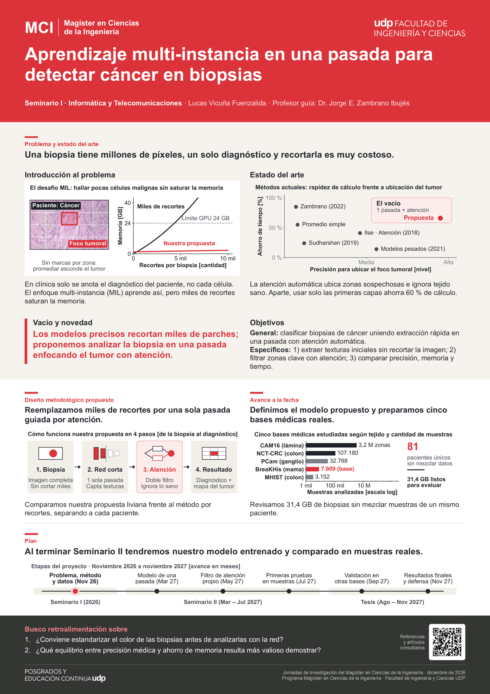
  </a>
</p>

---

## Resumen Ejecutivo

Este repositorio consolida el **análisis exploratorio (EDA)**, la **auditoría técnica completa de código y datos**, y la **hoja de ruta experimental** para diagnosticar cáncer en láminas histopatológicas digitales (**Whole Slide Images — WSI**, hasta ~100,000 &times; 100,000 px) mediante **Multiple Instance Learning (MIL)** y **Gated Attention** bajo una restricción estricta de almacenamiento (**&lt; 10 GB por dataset adicional**).

- **Portal Web Interactivo (GitHub Pages):** [https://petucode.github.io/magister-histopatologia-mil/](https://petucode.github.io/magister-histopatologia-mil/)
- **Presentación central de la reunión ("con peras y manzanas"):** [informe/presentacion_reunion_20_noviembre.html](informe/presentacion_reunion_20_noviembre.html) (conecta las reuniones del 25 Sep, 08 Oct y 09 Nov con las 5 bases de datos auditadas, simuladores interactivos y Teleprompter de orador).
- **Informe técnico exhaustivo post-auditoría:** [docs/ANALISIS_PROFUNDO.md](docs/ANALISIS_PROFUNDO.md).

### Hub de Presentaciones Dedicadas e Informes Guía por Dataset

| Dataset &amp; Notebook Auditado | Presentación HTML ("Peras y Manzanas") | Informe Guía de Exposición | Eje Metodológico y Literatura |
| :--- | :--- | :--- | :--- |
| **01 BreaKHis v1** ([`01_BreaKHis_EDA.ipynb`](notebooks/01_BreaKHis_EDA.ipynb)) | [01_breakhis.html](informe/datasets/01_breakhis.html) | [01_informe_breakhis.md](informe/guias/01_informe_breakhis.md) | 81 pacientes en 82 carpetas (`14-13412`), `GroupKFold`, *Spanhol 2016*, *Sudharshan 2019* &amp; capas intermedias (*Zambrano 2022*) |
| **02 PatchCamelyon** ([`02_PCam_EDA.ipynb`](notebooks/02_PCam_EDA.ipynb)) | [02_pcam.html](informe/datasets/02_pcam.html) | [02_informe_pcam.md](informe/guias/02_informe_pcam.md) | Regla centro `32×32` en `96×96` HDF5, señal verde `-0.100` H&amp;E y SSL (*Kang et al. CVPR 2023*) |
| **03 NCT-CRC-HE** ([`03_NCT_CRC_EDA.ipynb`](notebooks/03_NCT_CRC_EDA.ipynb)) | [03_nct_crc.html](informe/datasets/03_nct_crc.html) | [03_informe_nct_crc.md](informe/guias/03_informe_nct_crc.md) | 9 tejidos (`107,180` TIF), *domain shift* Macenko (`-30.77` brillo `BACK`), *RandStainNA* (*Kang 2023*, *Gadermayr 2024*) |
| **04 MHIST** ([`04_MHIST_EDA.ipynb`](notebooks/04_MHIST_EDA.ipynb)) | [04_mhist.html](informe/datasets/04_mhist.html) | [04_informe_mhist.md](informe/guias/04_informe_mhist.md) | Consenso 7 patólogos (`HP/SSA`), purga CSV falso, DUA BMIRDS &amp; transferencia bajo datos escasos |
| **05 CAMELYON16** ([`05_CAMELYON16_WSI.ipynb`](notebooks/05_CAMELYON16_WSI.ipynb)) | [05_camelyon16.html](informe/datasets/05_camelyon16.html) | [05_informe_camelyon16.md](informe/guias/05_informe_camelyon16.md) | 399 WSIs (`3.17M` coords), `111 XML`, `25,235 .npy`, *CLAM (2021)*, *TransMIL (2021)* y confiabilidad *PLOS One (2025)* |

### Continuidad Metodológica Entre Reuniones (25 Sep &rarr; 08 Oct &rarr; 09 Nov &rarr; 20 Nov)

| Reunión | Documento / Enfoque | Conexión Directa con las Bases de Datos Hoy |
| :--- | :--- | :--- |
| **25 Sep** | Seminario I: Capas intermedias CNN (`≤33%`, *Zambrano 2022*) vs parches (*Sudharshan 2019*) | **BreaKHis (`700×460`)** y **PCam (`96×96`)** permiten pase único sin reentrenamiento; *CLAM* también trunca ResNet50 tras el 3er bloque (`1024-d`). |
| **08 Oct** | Informe MIL: WSL (*Dietterich 1997*), dilución por promedio y muro de VRAM $O(K^2)$ | **CAMELYON16 (`123–35,766` parches/WSI)** hace obligatoria la extracción offline (UNI/iBOT) para entrenar en espacio de características. |
| **09 Nov** | *Ilse et al. (2018)*: Compuerta Hadamard $\tanh(Vh)\odot\sigma(Uh)$ y simulación *Peras y Manzanas* | Filtra tejido sano (`LYM`, `ADI`, `BACK` de **NCT-CRC**; ganglio sano de **CAMELYON16**), calibrada ante duda médica (**MHIST 4/7**). |
| **20 Nov** | Auditoría empírica de `31.4 GB` locales + validación espacial SOTA | Descubrimiento de `81 IDs`, `normal_map + 111 XML + 25,235 .npy` para medir confiabilidad *MI/AUPRC* (*Keshvarikhojasteh 2025*). |

---

## Arquitectura del Pipeline MIL en 2 Etapas

Para evitar el desborde computacional (~700 GB en WSIs crudas y ~30 GB por imagen sin comprimir en VRAM), se adopta un **pipeline desacoplado en dos etapas** conectado con el algoritmo de atención de [Ilse et al. (ICML 2018)](https://arxiv.org/abs/1802.04712):

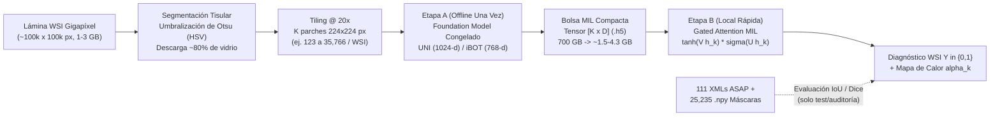

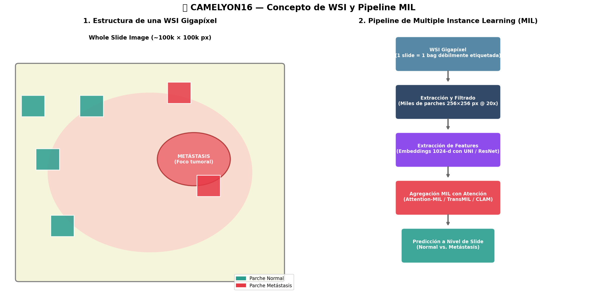

---

## Comparativa Estratégica y Hoja de Ruta

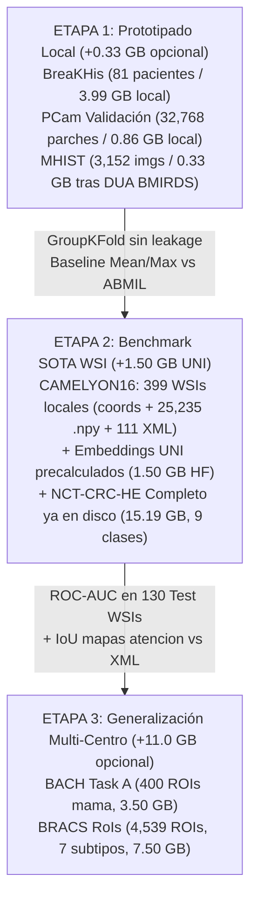

<p align="center">
  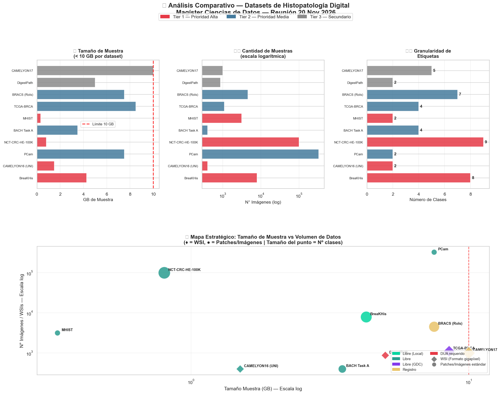
</p>

| Etapas del Plan | Dataset(s) | Descarga Adicional | Datos Locales Auditados | Objetivo Metodológico |
| :--- | :--- | :---: | :---: | :--- |
| **1 — Prototipado** | **BreaKHis** + **PCam Val** + *(MHIST DUA)* | `+0.00 GB` *(+0.33 GB opc.)* | `3.99 GB` + `0.86 GB` HDF5 | Baseline **Gated Attention** y control estricto `GroupKFold` por paciente |
| **2 — Benchmark SOTA** | **CAMELYON16 (UNI)** + **NCT-CRC-HE** | `+1.50 GB` UNI | `10.77 GB` CAM16 + `15.19 GB` NCT | Benchmark vs CLAM/TransMIL en 399 WSIs + validación espacial IoU/Dice |
| **3 — Generalización** | **BACH Task A** + **BRACS RoIs** | `+11.00 GB` *(máx 7.5 GB/ds)* | — | Evaluar transferencia de dominio en subtipos mamarios finos |

---

## Galería Visual Auditada por Dataset

> Todas las imágenes y estadísticas fueron **regeneradas tras corregir los bugs de la auditoría** ejecutando los 7 notebooks de principio a fin.

### 1. BreaKHis v1 (`3.99 GB` extraído / `4.27 GB` `.tar.gz`) — Carcinoma Mamario Multiescala
- **Volumen real:** **7,909 imágenes PNG** (`700 × 460 px`, 40x–400x) correspondientes a **81 pacientes únicos** en **82 carpetas clínicas** (`14-13412` comparte muestras de Carcinoma Ductal y Carcinoma Lobular). Balance: **31.4% Benigno (2,480)** vs **68.6% Maligno (5,429)**.
- **Corrección aplicada:** Se reparó el parser de paciente (`tokens[1]-tokens[2]`), pasando de 2 bolsas erróneas a **81 bolsas reales por paciente** (`~97.6` parches/paciente).

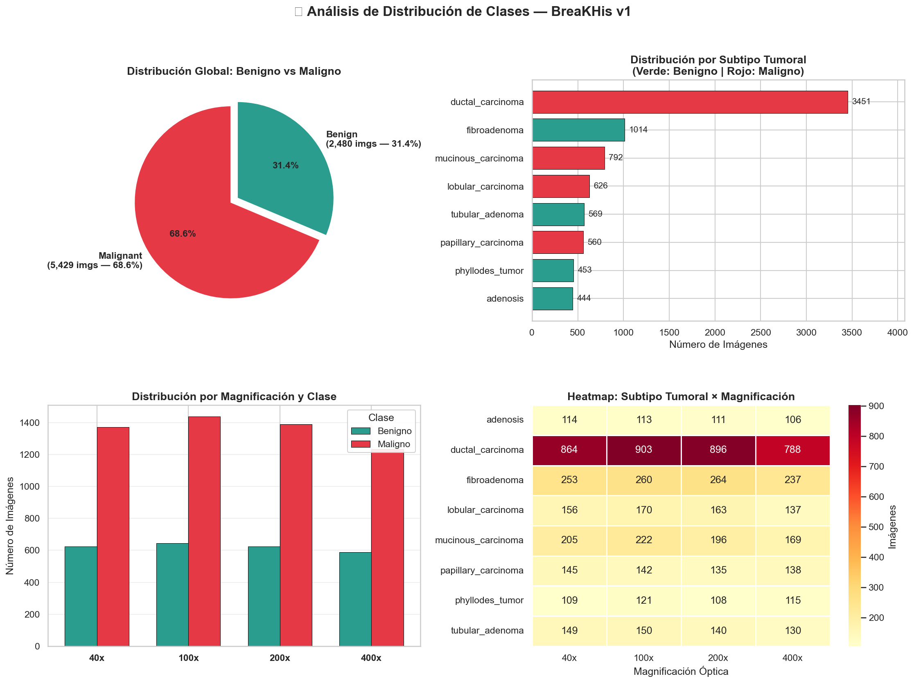

### 2. PatchCamelyon (PCam, `864.1 MB` HDF5) — Ventana Diagnóstica Central `32×32`
- **Volumen real:** Split de Validación completo en HDF5 (`camelyonpatch_level_2_split_valid_x.h5` + `_y.h5`): **32,768 parches (`96×96×3 uint8`)** perfectamente balanceados (**16,399 Normal [50.05%]** / **16,369 Tumor [49.95%]**).
- **Lectura espectral H&E:** El canal Verde desciende de `0.5849` (normal) a `0.4847` (tumor) debido a la mayor absorción nuclear por Hematoxilina.

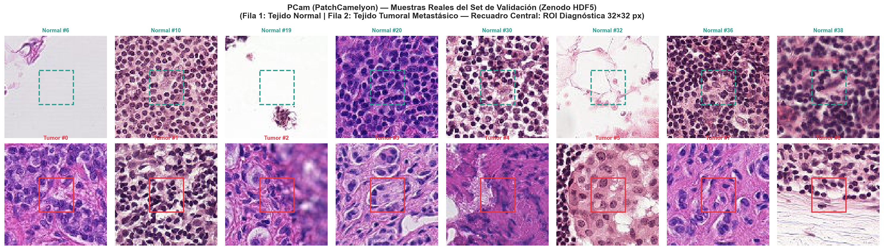

### 3. NCT-CRC-HE-100K & CRC-VAL-HE-7K (`15.19 GB`) — 9 Tejidos del Colon
- **Volumen real:** Dataset completo extraído (**100,000** parches Train `14.44 GB` + **7,180** parches Validación externa `0.75 GB` de 50 pacientes independientes = **107,180 `.tif`**).
- **Hallazgo técnico:** Diferencia sistemática de brillo entre splits (ej. `BACK`: `142.1` en Train vs `111.3` en Val), haciendo imprescindible la **normalización cromática Macenko / Vahadane**.

| 9 Clases Tisulares (224×224 px @ 20x) | Comparativa Train (100K) vs Validación (7K) |
| :---: | :---: |
| 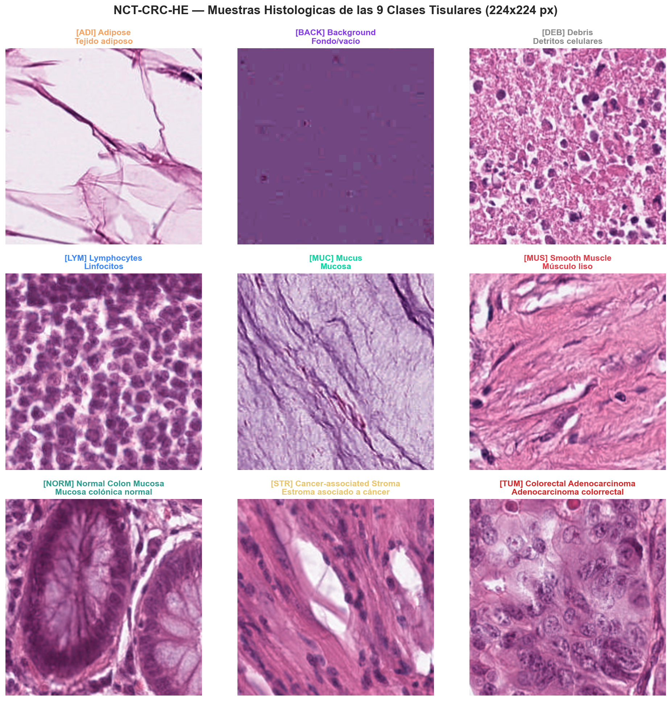 | 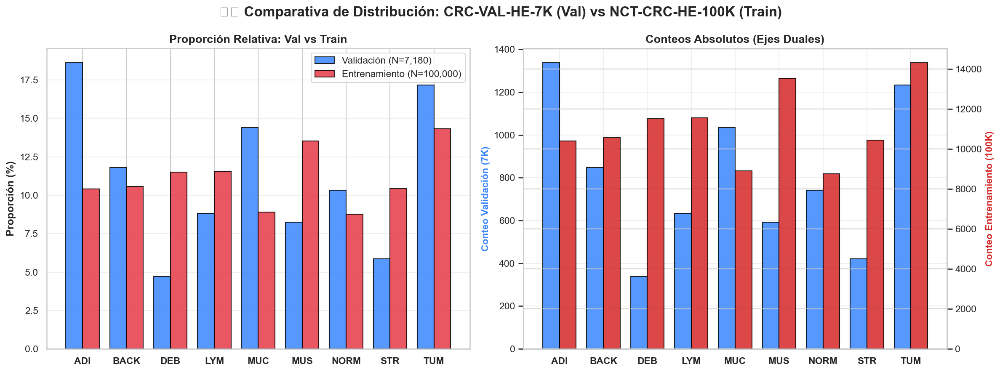 |

### 4. CAMELYON16 (`10.77 GB` locales) — `399` WSIs + `25,235` Parches `.npy` + `111` XMLs
- **Coordenadas (`36.41 MB`):** `399` directorios (**159 Normal Train**, **110 Tumor Train**, **130 Test**) con **3,177,267 parches** totales (`min=123`, `mediana=6,813`, `media=7,963`, `máx=35,766` parches por WSI).
- **Máscaras XML (`55.84 MB` + `normal_map.xlsx`):** `111` anotaciones poligonales ASAP + tabla `160×2` de particiones normales.
- **Parches `.npy` (`10.68 GB`):** **`25,235` archivos** (`classifier/train`: 10,997; `classifier/val`: 1,647; `test` L3: 2,585; `unet`: 10,006) con diccionarios `{'image': (256,256,3) uint8, 'mask': (256,256)}` — ¡oro puro para evaluar si el mapa de atención MIL apunta al tumor real!

| Mapa Espacial 2D Corregido (`coords[:, 1:3]`) | Muestras `.npy` Reales + Máscara Ground Truth |
| :---: | :---: |
| 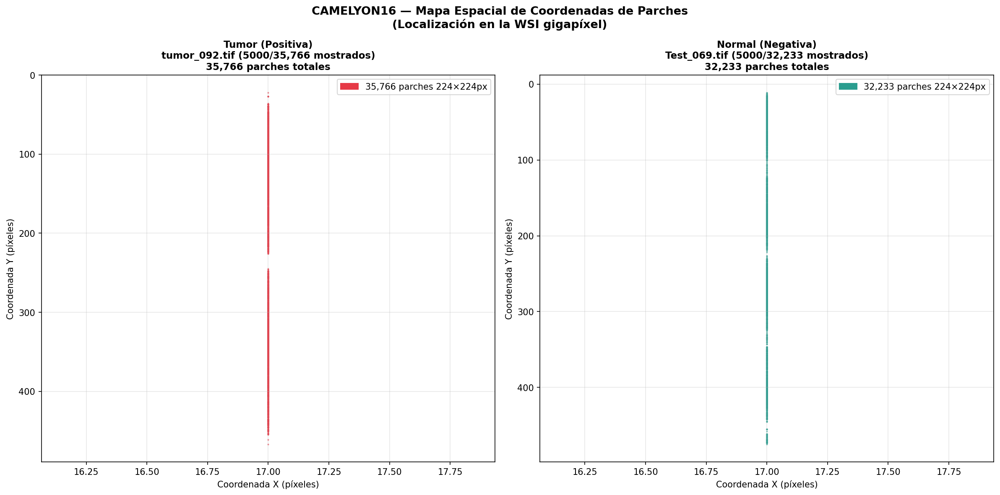 | 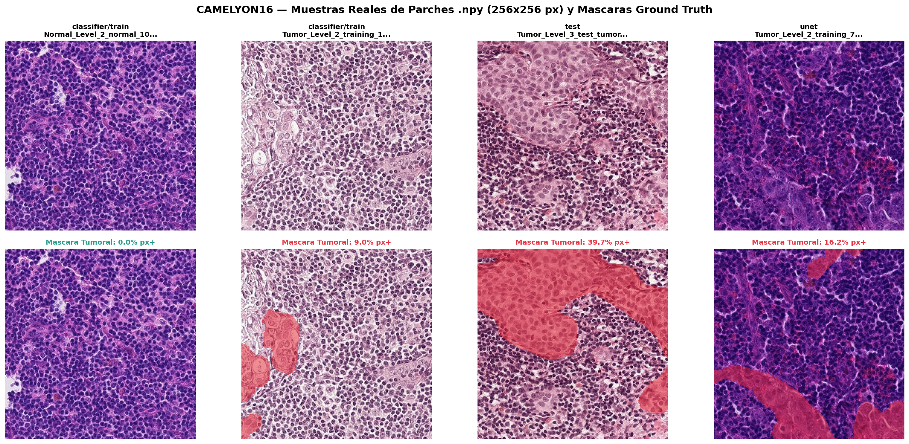 |

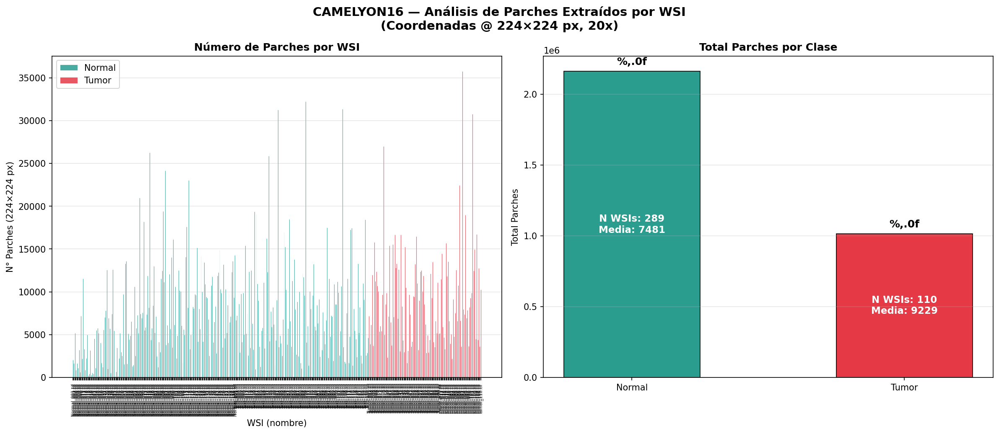

### 5. MHIST (`0.33 GB` ref.) — Consenso de 7 Patólogos (DUA BMIRDS)
- Requiere aceptar el **Dataset Research Use Agreement** en [bmirds.github.io/MHIST/](https://bmirds.github.io/MHIST/). Se purgó un CSV sintético previo corrupto y se reconstruyó `04_MHIST_EDA.ipynb` con la **Tabla 1 oficial de Wei et al. (AIME 2021)** (`Train: 1,545 HP / 630 SSA`; `Test: 617 HP / 360 SSA`).

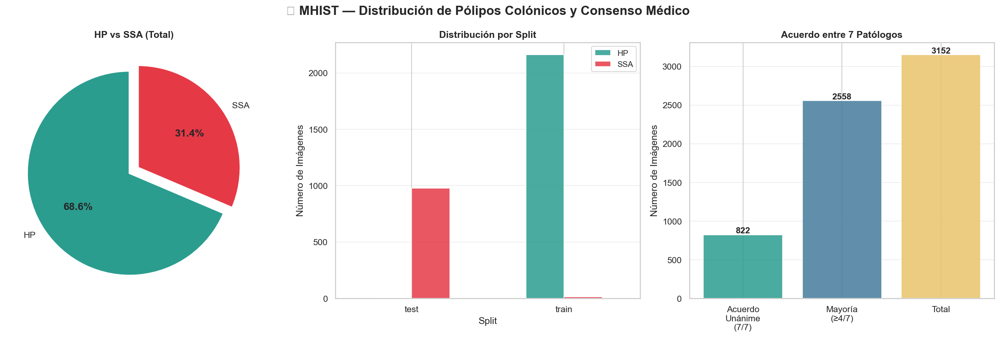

---

## Auditoría Completa: 7 Hallazgos Resueltos

| # | Archivo / Módulo | Problema Detectado | Solución Verificada Post-Ejecución |
| :---: | :--- | :--- | :--- |
| **1** | `notebooks/01_BreaKHis_EDA.ipynb` | `tokens[1]` truncaba paciente a `"14"` &rarr; reportaba solo **2** pacientes. | Parser corregido a `f"{tokens[1]}-{tokens[2]}"` &rarr; **81 pacientes únicos en 82 carpetas** (`14-13412` en DC+LC). Tamaño armonizado a **3.99 GB**. |
| **2** | `scripts/analizar_camelyon16_coords.py` | Graficaba `coords[:, 0]` (`level=17` constante = líneas verticales), metía Test en Normal e imprimía `'%,.0f'`. | Corregido a `coords[:, 1:3]`, 3 cohortes reales (`159/110/130`) y etiquetas formateadas. |
| **3** | `notebooks/04_MHIST_EDA.ipynb` | URL GitHub 404 + CSV sintético corrupto (`Test=100% SSA`, votos aleatorios). | Eliminado CSV/figuras falsas; validación estricta + Tabla 1 oficial Wei et al. (2021) + enlace DUA BMIRDS. |
| **4** | `notebooks/05_CAMELYON16_WSI.ipynb` | `25,235` parches `.npy` (`10.68 GB`) y `normal_map.xlsx` indocumentados; tarjeta decía `624` vs mínimo real `123`. | Indexado completo en `camelyon16_patches_inventario.xlsx`, galería con máscaras (`camelyon16_patches_muestras.png`) y tarjeta dinámica (`123–35,766`). |
| **5** | `notebooks/00_Resumen_...ipynb` | Filtro `Acceso == 'Libre'` pintaba PCam, NCT-CRC y CAMELYON16 en rojo como "requiere registro". | Corregido a `.startswith('Libre')` y reubicadas etiquetas del scatter fuera de la línea de 10 GB. |
| **6** | `figures/` &amp; `notebooks/00..06` | Glifos `□` en títulos Matplotlib, leyenda encimada en comparativa final, paneles duplicados (`twinx`/`cbar`) y PNGs huérfanos en raíz. | Purgados 35 artefactos obsoletos/duplicados; cero glifos `□`, radar limpio sin recortes y layouts corregidos. |
| **7** | `notebooks/00` vs `06` | Contradicción en Tiers y suma `~8.4 GB` aritméticamente incoherente. | Tiers unificados y suma exacta documentada (`+1.83 GB` Etapa 1+2 nuevas; `+11.00 GB` Etapa 3 opcional, máx `7.50 GB/dataset`). |

---

## Sinergia con Ramos Previos (`Materia Util/`)

La auditoría de los 4 cursos locales en `Materia Util/` (`5.16 GB`, excluidos de Git junto a credenciales `kaggle.json`) permite reutilizar implementaciones previas directamente en la tesis:

| Curso Local | Artefactos Clave | Aplicación Directa en la Tesis MIL |
| :--- | :--- | :--- |
| **Procesamiento de Imágenes** | `utils/funciones.py` (`otsu`, `opening/closing`, `Dice/IoU`) | Segmentación automática de tejido WSI + evaluación **IoU / Dice** entre atención \(\alpha_k\) y XMLs/máscaras CAMELYON16 |
| **Deep Learning** | `vectorizacion.py`, `Tarea_2.ipynb` (PyTorch / diagnóstico GPU RX 9060 XT), `Tarea-3` | Multiplicación tensorial vectorizada para bolsas de tamaño variable \(K \in [123, 35766]\) sin bucles ni desborde de memoria |
| **Data Science** | Flujos de limpieza tabular y `RoadMap.txt` | Control de duplicados/leakage (`GroupKFold` por paciente) y evaluación ROC-AUC/PR-AUC bajo desbalance |
| **Inteligencia Artificial** | Muestreo heurístico *(excluyendo `kaggle.json` vía `.gitignore`)* | Selección heurística de parches difíciles (*hard-negative mining*) |

---

## Estructura del Repositorio

```text
├── README.md                          # Portada técnica con diagramas Mermaid y galería visual
├── index.html                         # Redirección GitHub Pages a la presentación interactiva
├── .gitignore                         # Excluye data_samples/ (27.4 GB), Materia Util/ (5.16 GB), tokens y binarios
├── docs/
│   └── ANALISIS_PROFUNDO.md           # Análisis técnico archivo por archivo y mapeo de cursos
├── informe/
│   └── presentacion_reunion_20_noviembre.html  # Presentación HTML5 (17 slides + simuladores + guion)
├── notebooks/
│   ├── 00_Resumen_Datasets_Histopatologia.ipynb
│   ├── 01_BreaKHis_EDA.ipynb
│   ├── 02_PCam_EDA.ipynb
│   ├── 03_NCT_CRC_EDA.ipynb
│   ├── 04_MHIST_EDA.ipynb
│   ├── 05_CAMELYON16_WSI.ipynb
│   └── 06_Comparativa_Final.ipynb
├── scripts/
│   ├── 00_install_dependencies.py
│   ├── analizar_camelyon16_coords.py  # Corregido: coords[:, 1:3] y 3 cohortes reales
│   ├── analyze_and_generate.py
│   ├── build_notebook.py              # Sincronizado con 03_NCT_CRC_EDA.ipynb
│   ├── check_camelyon_sources.py
│   ├── download_train.py
│   └── download_val.py
├── figures/                           # Gráficos y muestras organizados por notebook (00_Resumen .. 06_Comparativa)
└── tablas/                            # 36 libros Excel (.xlsx) generados determinísticamente por los notebooks
```

## Reproducción Local

```bash
# 1. Instalar dependencias mínimas (preferible entorno conda / venv Python 3.10+)
python scripts/00_install_dependencies.py

# 2. Verificar que no existen datos ni secretos expuestos antes de commitear
git status

# 3. Abrir la presentación interactiva localmente
# Doble clic en informe/presentacion_reunion_20_noviembre.html
```
