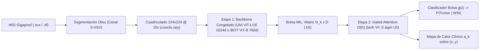

# 🔬 Histopatología Digital & Multiple Instance Learning (MIL)

**Proyecto de Investigación — Magíster en Ciencias de la Computación / Ciencia de Datos**  
**Institución:** Universidad Diego Portales (UDP) — Facultad de Ingeniería y Ciencias  
**Estudiante:** Lucas Vicuña · **Profesor Guía:** Dr. Jorge Eduardo Zambrano Ibujés  
**Hito:** Reunión de Avance — 20 Noviembre 2026

---

## 🎯 Propósito del Repositorio

Este proyecto evalúa, descarga, audita y prepara **datasets públicos de histopatología digital** para entrenar y comparar arquitecturas de **Aprendizaje de Múltiples Instancias (Multiple Instance Learning, MIL)** —específicamente *Gated Attention MIL* (Ilse et al., ICML 2018), *CLAM* (Lu et al., 2021) y *TransMIL* (Shao et al., 2021)— bajo una restricción operacional estricta de almacenamiento local (**< 10 GB por dataset**) y cómputo desacoplado en hardware local (**AMD Radeon RX 9060 XT / PyTorch CPU**, sin CUDA NVIDIA).

> [!IMPORTANT]
> Para una disección línea a línea de todos los notebooks, scripts, tablas Excel, artefactos ocultos en disco, errores detectados en la auditoría y mapeo completo con los ramos del magíster, consulta **[docs/ANALISIS_PROFUNDO.md](docs/ANALISIS_PROFUNDO.md)** y abre la presentación interactiva **[informe/presentacion_reunion_20_noviembre.html](informe/presentacion_reunion_20_noviembre.html)**.

---

## 🏗️ Arquitectura General del Proyecto

```mermaid
flowchart TB
    subgraph SRC["Fuentes Externas y Locales"]
        Z1["Zenodo 2546921 (PCam HDF5)"]
        Z2["Zenodo 1214456 (NCT-CRC-HE)"]
        GC["CAMELYON16 / Kaggle (Coords, XML, Patches)"]
        GH["GitHub bmirds/mhist (Annotations)"]
        BK["Disco Local Externo (BreaKHis_v1 PNG)"]
    end

    subgraph DATA["data_samples/ (~27.4 GB locales, excluidos de Git)"]
        D_PCAM["pcam/ (2 .h5 | 864 MB)"]
        D_NCT["nct_crc/ (107,180 .tif | 15.19 GB)"]
        D_CAM_C["camelyon16/coords/ (399 coords.npy | 36 MB)"]
        D_CAM_M["camelyon16/masks/ (111 .xml + normal_map.xlsx | 56 MB)"]
        D_CAM_P["camelyon16/patches/ (25,235 .npy | 10.68 GB)"]
        D_MH["mhist/ (annotations.csv | 0.08 MB)"]
    end

    subgraph PROC["Notebooks (00..06) y Scripts (scripts/)"]
        NB00["00_Resumen_Datasets_Histopatologia.ipynb"]
        NB01["01_BreaKHis_EDA.ipynb"]
        NB02["02_PCam_EDA.ipynb"]
        NB03["03_NCT_CRC_EDA.ipynb"]
        NB04["04_MHIST_EDA.ipynb"]
        NB05["05_CAMELYON16_WSI.ipynb"]
        NB06["06_Comparativa_Final.ipynb"]
        SC["scripts/ (download, analyze, build_notebook)"]
    end

    subgraph OUT["Artefactos Generados y Entregables"]
        TAB["tablas/ (40 archivos .xlsx)"]
        FIG["figures/ (106 archivos .png)"]
        DOC["docs/ANALISIS_PROFUNDO.md"]
        PPT["informe/presentacion_reunion_20_noviembre.html"]
    end

    Z1 --> D_PCAM --> NB02
    Z2 --> D_NCT --> NB03
    GC --> D_CAM_C & D_CAM_M & D_CAM_P
    D_CAM_C & D_CAM_M --> NB05
    GH --> D_MH --> NB04
    BK --> NB01
    SC --> D_NCT & NB03 & TAB & FIG
    NB00 & NB01 & NB02 & NB03 & NB04 & NB05 & NB06 --> TAB & FIG
    TAB & FIG --> DOC & PPT
```



---

## 📁 Estructura del Repositorio

```text
20 Noviembre Reunion/
├── .gitignore                          # Excluye ~27.4 GB de datasets, Materia Util y credenciales
├── README.md                           # Documentación principal (este archivo)
├── docs/
│   └── ANALISIS_PROFUNDO.md            # Auditoría integral, diagramas y cruce con Materia Util
├── informe/
│   └── presentacion_reunion_20_noviembre.html  # Presentación HTML5 interactiva con Teleprompter
├── Presentacion de ejemplo/
│   └── presentaci_n_interactiva_mag_ster_gated_attention_y_el_departamento_de_detectives.html
├── notebooks/                          # 7 Jupyter Notebooks de EDA y síntesis
│   ├── 00_Resumen_Datasets_Histopatologia.ipynb
│   ├── 01_BreaKHis_EDA.ipynb
│   ├── 02_PCam_EDA.ipynb
│   ├── 03_NCT_CRC_EDA.ipynb
│   ├── 04_MHIST_EDA.ipynb
│   ├── 05_CAMELYON16_WSI.ipynb
│   ├── 06_Comparativa_Final.ipynb
│   └── test_mapa_coords.png            # Mapa espacial 2D correcto de CAMELYON16 (Normal_076 vs tumor_092)
├── scripts/                            # 7 scripts Python de soporte y automatización
│   ├── 00_install_dependencies.py
│   ├── analizar_camelyon16_coords.py
│   ├── analyze_and_generate.py
│   ├── build_notebook.py
│   ├── check_camelyon_sources.py
│   ├── download_train.py
│   └── download_val.py
├── tablas/                             # 40 libros Excel (.xlsx) generados por notebooks/scripts
├── figures/                            # 106 gráficos PNG (combinados y paneles individuales @ 150 DPI)
│   ├── 00_Resumen/ ... 06_Comparativa/
├── data_samples/                       # [IGNORADO EN GIT] ~27.4 GB de muestras descargadas
└── Materia Util/                       # [IGNORADO EN GIT] Apuntes y tareas de 4 ramos del Magíster
```

---

## 📊 Inventario Real de Datasets en Disco vs. Catálogo Evaluado

| Dataset | Órgano | Clases | Estado Real en Disco | Tamaño Real | Notebook Asociado |
| :--- | :--- | :---: | :--- | :---: | :--- |
| **BreaKHis v1** | Mama | 2 / 8 | Ruta externa `C:\Universidad\Magister\Datasets\BreaKHis_v1\` (7,909 PNGs, 700×460) | ~7.9 GB *(externo)* | [`01_BreaKHis_EDA.ipynb`](notebooks/01_BreaKHis_EDA.ipynb) |
| **PCam** | Linfonodo | 2 | Descargado split `valid`: 32,768 parches 96×96×3 en HDF5 | 864.10 MB | [`02_PCam_EDA.ipynb`](notebooks/02_PCam_EDA.ipynb) |
| **NCT-CRC-HE** | Colon/Recto | 9 | Completo: `100K` (100,000 `.tif`) + `VAL-7K` (7,180 `.tif`) = 107,180 parches 224×224 | 15.19 GB | [`03_NCT_CRC_EDA.ipynb`](notebooks/03_NCT_CRC_EDA.ipynb) |
| **MHIST** | Colon | 2 | Solo `annotations.csv` (3,152 filas sintéticas; **sin imágenes PNG**) | 0.08 MB | [`04_MHIST_EDA.ipynb`](notebooks/04_MHIST_EDA.ipynb) |
| **CAMELYON16** | Linfonodo | 2 | **3 activos**: `coords.npy` (399 WSIs = 3.17M coords), `masks/` (111 XML + `normal_map.xlsx`), `patches/` (25,235 `.npy` `256×256` sin usar en notebooks) | 10.77 GB | [`05_CAMELYON16_WSI.ipynb`](notebooks/05_CAMELYON16_WSI.ipynb) |
| **BACH / BRACS / DigestPath / TCGA-BRCA / CAMELYON17** | Mama / Colon / Linfonodo | 2–7 | Evaluados teóricamente en comparativa y hoja de ruta (no descargados) | — | [`00_Resumen`](notebooks/00_Resumen_Datasets_Histopatologia.ipynb), [`06_Comparativa`](notebooks/06_Comparativa_Final.ipynb) |

---

## 🔄 Pipeline MIL Desacoplado (Two-Stage Architecture)

Dado el tamaño gigapíxel de las láminas WSI (`~100,000 × 100,000 px`) y la ausencia de GPU NVIDIA CUDA en el equipo local (**AMD Radeon RX 9060 XT**, PyTorch CPU), el proyecto adopta un flujo desacoplado en dos etapas:



---

## ⚠️ Hallazgos Críticos de Auditoría Técnica

Al inspeccionar directamente el código, las salidas ejecutadas, los archivos `.xlsx`, los `.npy` y los gráficos generados, se detectaron **5 anomalías importantes** que deben corregirse antes de entrenar modelos MIL:

1. **Bug de agrupación por paciente en BreaKHis ([`01_BreaKHis_EDA.ipynb`](notebooks/01_BreaKHis_EDA.ipynb))**: `paciente = tokens[1]` toma el año `'14'`/`'15'` de `SOB_B_A-14-22549AB-100-001.png` en lugar de `tokens[1]-tokens[2]` (`14-22549AB`), colapsando **82 pacientes reales en solo 2 bolsas** dentro de [`breakhis_bags_pacientes.xlsx`](tablas/breakhis_bags_pacientes.xlsx).
2. **CSV sintético corrupto en MHIST (`data_samples/mhist/annotations.csv`)**: El archivo en disco proviene de un fallback sintético (`MHIST_A00.png`..``MHIST_`51.png``), con votos aleatorios inconsistentes y un split roto (`train`: 99.4% HP / 0.6% SSA; `test`: 100% SSA), contaminando las 5 tablas `mhist_*.xlsx` y las figuras de `figures/04_MHIST/`.
3. **Sobrescritura defectuosa en coordenadas de CAMELYON16**: [`scripts/analizar_camelyon16_coords.py`](scripts/analizar_camelyon16_coords.py) indexó `coords[:, 0]` (nivel piramidal = `17`) como eje X, sobrescribiendo [`camelyon16_coords_por_wsi.xlsx`](tablas/camelyon16_coords_por_wsi.xlsx) y [`figures/05_CAMELYON16/camelyon16_mapa_coords.png`](figures/05_CAMELYON16/camelyon16_mapa_coords.png) con una línea vertical en `X=17`. El mapa 2D correcto existe únicamente en [`notebooks/test_mapa_coords.png`](notebooks/test_mapa_coords.png).
4. **Activo oculto de 10.68 GB sin documentar**: Existen **25,235 archivos `.npy`** (`dict` con `'image'` `256×256×3 uint8` y `'mask'`) en `data_samples/camelyon16/patches/data/{classifier,unet,test}`, además de `normal_map.xlsx` (160 filas), que ningún notebook ni script indexa actualmente.
5. **Inconsistencias menores entre notebooks**: Tres tablas mencionadas en salidas de `05_CAMELYON16_WSI.ipynb` (`camelyon16_coordenadas_extremos.xlsx`, `camelyon16_pipeline_mil.xlsx`, `camelyon16_estrategia_mil.xlsx`) no están en `tablas/`; el volumen en disco (`27.4 GB`) supera el tope teórico declarado (`~8.4 GB`); y hay divergencias de Tiers/tamaños entre `00_Resumen` y `06_Comparativa`.

---

## 🎓 Integración con `Materia Util/` (4 Ramos del Magíster)

| Ramo | Material Clave en `Materia Util/` | Aplicación Directa al Proyecto MIL |
| :--- | :--- | :--- |
| **Procesamiento de Imágenes** | `Clase 5-6` (Histogramas, Espacios de Color), `Clase 7-9` (Filtros, LoG, Canny), `Clase 11` (Morfología), `Tarea 1/utils/funciones.py` (CLAHE, Gamma, LUTs) | Segmentación tisular HSV + Otsu + apertura/cierre morfológico; normalización cromática H&E (CLAHE en luminancia YCrCb vs Macenko); detección de bordes nucleares. |
| **Deep Learning** | `Clases 6-13` (CNNs, Secuenciales/Gates), `vectorizacion.py`, `T1` (AutoML KerasTuner), `T2` (PyTorch `resnet50`/`mobilenet_v2`/`googlenet`, detección GPU AMD RX 9060 XT vs CPU) | Mecanismos de compuertas multiplicativas (*Gating*), Transfer Learning en PyTorch para baselines de parches (PCam/NCT-CRC) y optimización para CPU / DirectML sin CUDA. |
| **Inteligencia Artificial** | `Clases 2-8` (Bayes, MLE, EM), `Clases 10-18` (Clustering, SVM, Regularización, ANN), `Tarea 3` (Generalización multi-dominio `D1`/`D2` → `T`) | Modelado probabilístico EM del consenso de 7 patólogos en MHIST; pérdidas Smooth SVM (núcleo de CLAM); evaluación de *domain shift* entre centros médicos. |
| **Data Science** | `Clases 4-6` (Limpieza, Outliers, EDA), `Clase 14` (Reducción dimensional), `Clases 15-17` (Overfitting, Regularización, Imbalance/Tuning), `Clase 19` (Interpretabilidad), `Clase 23` (Streamlit) + `Proyecto-Final` | Balanceo de clases (BreaKHis 31/69%, CAMELYON16), proyección UMAP/PCA de embeddings UNI 1024-d, regularización con pocas bolsas ($N=82$–$399$), y despliegue visual de mapas de calor. |

---

## 🚀 Orden de Ejecución Recomendado

1. **Dependencias:** `python scripts/00_install_dependencies.py` (asegurando Python con `numpy`, `pandas`, `matplotlib`, `seaborn`, `h5py`, `openpyxl`, `tqdm`, `Pillow`, `requests`).
2. **EDA Secuencial:** Ejecutar en orden los notebooks `00` → `01` → `02` → `03` → `04` → `05` → `06` desde `notebooks/`.
3. **Presentación:** Abrir `informe/presentacion_reunion_20_noviembre.html` en cualquier navegador moderno (incluye KaTeX, gráficos interactivos, figuras reales y guion del orador).

---

## 🔗 Enlace con GitHub

El repositorio local ya está inicializado con un `.gitignore` seguro (excluye `data_samples/`, `Materia Util/` y tokens `kaggle.json`). Para enlazarlo y subirlo a tu cuenta de GitHub (`Petucode`):

```bash
git add .
git commit -m "chore: analisis profundo, diagramas, README y presentacion reunion 20 Nov"
git branch -M main
git remote add origin https://github.com/Petucode/<NOMBRE_DEL_REPOSITORIO>.git
git push -u origin main
```
