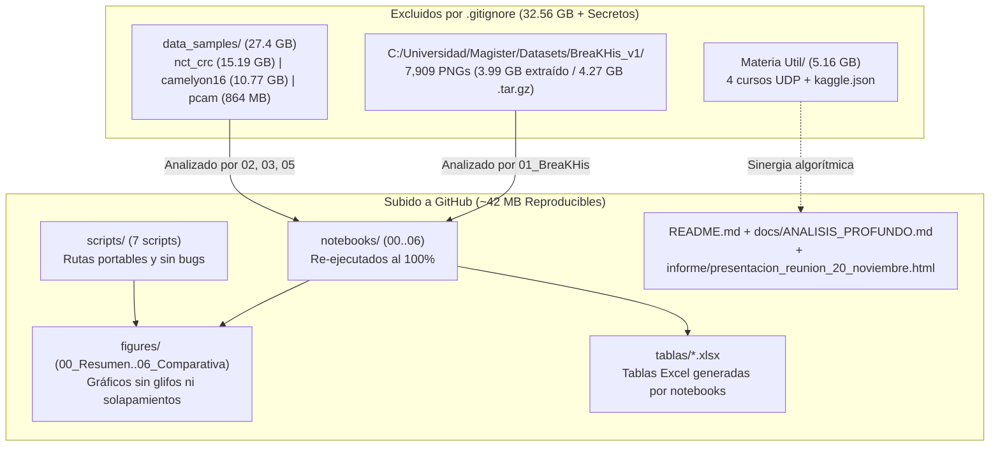
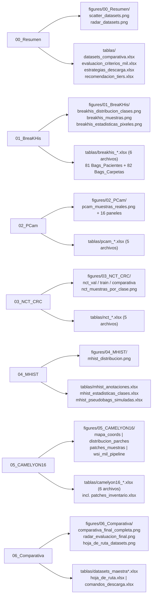
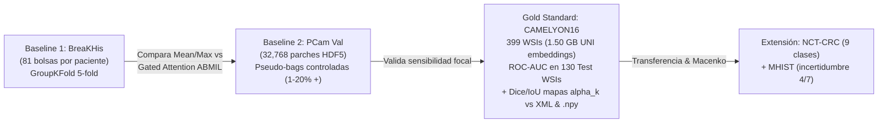

# Análisis Técnico Profundo — Proyecto Magíster en Histopatología Digital & MIL

> **Documento Técnico de Auditoría y Arquitectura** &bull; Última actualización post-correcciones y re-ejecución íntegra de los 7 notebooks (`exit code 0`).

---

## 1. Arquitectura Global del Ecosistema Local vs GitHub

---

## 2. Inventario Verificado en Disco (Real vs Referencia)

| Componente | Ruta / Alcance | Archivos Reales | Volumen en Disco | Hallazgo Clave Post-Auditoría |
| :--- | :--- | :---: | :---: | :--- |
| **BreaKHis v1** | Externa: `C:\Universidad\Magister\Datasets\BreaKHis_v1` | `7,909` `.png` | `3.99 GB` *(4.27 GB tar.gz)* | **81 pacientes únicos** en **82 carpetas clínicas** (`14-13412` comparte DC + LC); 31.4% benigno / 68.6% maligno |
| **PCam (Val)** | `data_samples/pcam/` | `2` `.h5` | `864.10 MB` | `32,768` parches `96×96×3 uint8`: `16,399` Normal (`50.05%`) / `16,369` Tumor (`49.95%`). Canal G cae `-0.10` en tumor |
| **NCT-CRC-HE** | `data_samples/nct_crc/` | `107,180` `.tif` | `15.19 GB` | `100,000` Train (`14.44 GB`) + `7,180` Val (`0.75 GB`, 50 pacientes); brillo `BACK` `142.1` vs `111.3` exige normalización Macenko |
| **CAMELYON16 Coords** | `data_samples/camelyon16/coords/CAMELYON16_FULL/` | `399` `coords.npy` | `36.41 MB` | `159` Normal + `110` Tumor + `130` Test = **3,177,267 parches** (`min=123`, `mediana=6,813`, `máx=35,766`) |
| **CAMELYON16 Masks** | `data_samples/camelyon16/masks/` | `111` `.xml` + `normal_map.xlsx` | `55.84 MB` | Polígonos ASAP Nivel 0 (ej. `tumor_001.xml`: 2 regiones, 855 + 1,657 vértices) + mapeo de 160 slides normales |
| **CAMELYON16 Patches** | `data_samples/camelyon16/patches/data/` | `25,235` `.npy` | `10.68 GB` | Dict `{'image': (256,256,3) uint8, 'mask': (256,256)}`; `classifier/train` (10,997), `classifier/val` (1,647), `test` L3 (2,585), `unet` (10,006) |
| **MHIST** | Modo Referencia *(DUA BMIRDS pendiente)* | `0` locales *(ref. 3,152)* | `0.33 GB` en portal | CSV sintético corrupto purgado; cifras exactas de **Wei et al. (2021) Tabla 1**: Train `1,545 HP / 630 SSA`, Test `617 HP / 360 SSA` |

---

## 3. Flujo Detallado por Notebook y Artefactos Producidos

---

## 4. Detalle Técnico de las 7 Correcciones de Auditoría

1. **`01_BreaKHis_EDA.ipynb` (Fuga de datos por paciente resuelta):**
   - El formato real de nombres en BreaKHis es `SOB_<tipo>_<subtipo>-<prefijo>-<paciente>-<mag>-<seq>.png` (ej. `SOB_B_A-14-22549AB-40-001.png`).
   - El parser original leía `tokens[1]` (`"14"`), colapsando los 7,909 archivos en apenas **2** supuestos pacientes. Con `f"{tokens[1]}-{tokens[2]}"` se recuperaron los **81 IDs únicos de paciente** distribuidos en **82 carpetas clínicas** (revelando que el paciente `14-13412` aparece simultáneamente en `SOB_M_DC_14-13412` y `SOB_M_LC_14-13412`).
   - Se actualizaron `breakhis_bags_pacientes.xlsx` (hojas `Bags_Pacientes` con 81 filas y `Bags_Carpetas_82` con 82 filas) y `breakhis_resumen_informe.xlsx` (`3.99 GB extraído`, `31.4% Benigno / 68.6% Maligno`).

2. **`scripts/analizar_camelyon16_coords.py` & `05_CAMELYON16_WSI.ipynb`:**
   - Cada `coords.npy` posee forma `(N, 3)` tipo `<f4` con columnas `[level=17, x, y]`. El script analizaba `coords[:, 0]` como eje `X` (produciendo líneas verticales constantes en `X=17` en `camelyon16_mapa_coords.png`), clasificaba `Test_*` dentro de `Normal` (`289` vs `159`), y usaba `fmt='%,.0f'` inválido en `ax.bar_label`.
   - En `05_CAMELYON16_WSI.ipynb` se corrigió además el texto de la tarjeta derecha (`123`–`35,766` parches dinámicos en vez del `624` rígido), se hicieron portables las rutas vía `BASE_DIR`, se incorporó la lectura de `normal_map.xlsx` (160 filas), se indexaron los **25,235 `.npy`** en `tablas/camelyon16_patches_inventario.xlsx`, se generó `camelyon16_patches_muestras.png` (4 tejidos reales distintos + máscaras rojas) y se regeneró limpiamente `camelyon_wsi_mil_pipeline.png`.

3. **`04_MHIST_EDA.ipynb` (Eliminación de fallback sintético inválido):**
   - La URL histórica `raw.githubusercontent.com/bmirds/mhist/master/annotations.csv` devuelve HTTP `404` porque Dartmouth BMIRDS distribuye MHIST únicamente tras completar el **Dataset Research Use Agreement (DUA)** en [https://bmirds.github.io/MHIST/](https://bmirds.github.io/MHIST/).
   - El archivo local `data_samples/mhist/annotations.csv` había sido creado por el antiguo bloque `else:` generando `MHIST_A00.png` con splits desbalanceados (`Test: 0 HP / 977 SSA`, `Train: 2162 HP / 13 SSA`) y votos independientes aleatorios donde `Votos_HP + Votos_SSA != 7`.
   - Se eliminaron el CSV falso y sus gráficos derivados (`mhist_acuerdo_patologos*`, `mhist_distribucion_real*`, `mhist_muestras_hp_vs_ssa.png`). El notebook valida estrictamente si el usuario descargó el CSV oficial y, en caso contrario, reporta con transparencia las cifras exactas de la **Tabla 1 de Wei et al. (2021)** (`Train: 1,545 HP + 630 SSA`; `Test: 617 HP + 360 SSA`) sin fabricar votos sintéticos.

4. **`00_Resumen_Datasets_Histopatologia.ipynb` & `06_Comparativa_Final.ipynb`:**
   - En `00` Celda 9, `row['Acceso'] == 'Libre'` excluía `'Libre (HuggingFace)'`, `'Libre (Zenodo)'` y `'Libre (camelyon16...)'`, pintando verdes datasets abiertos en rojo. Corregido a `.startswith('Libre')`.
   - Eliminados todos los emojis incompatibles con `DejaVu Sans` (cajas `□`), separada la leyenda superior del `suptitle` en `comparativa_final_completa.png`, reubicadas anotaciones sin colisión sobre los círculos, reubicadas etiquetas radiales fuera de `r=5` en ambos radares, armonizado `BreaKHis` (`3.99 GB`), armonizada la clasificación de **Tiers 1/2/3** entre `00` y `06`, y corregida la suma de descargas adicionales (`+1.83 GB` Etapa 1+2; `+11.00 GB` Etapa 3 opcional, máx `7.50 GB` por dataset).

5. **`03_NCT_CRC_EDA.ipynb` & `scripts/build_notebook.py`:**
   - Sincronizados ambos archivos con `BASE_DIR` portable, eliminación de glifos `□`, deduplicación de ejes gemelos (`twinx()`) y colorbars (`<colorbar>`) en `guardar_subplots_individuales`, y tamaño exacto (`14.44 + 0.75 = 15.19 GB`).

---

## 5. Formulación Matemática y Diseño de Experimentos MIL

Para el prototipo de tesis se formaliza cada lámina \(X_i = \{x_{i,1}, \dots, x_{i,K_i}\}\) mediante embeddings \(h_{i,k} = f_{\theta}(x_{i,k}) \in \mathbb{R}^D\) extraídos offline (\(D = 1024\) en UNI o \(D = 768\) en iBOT ViT-Base) y agregados con **Gated Attention ([Ilse et al., 2018](https://arxiv.org/abs/1802.04712))**:

$$
a_k = \frac{\exp\!\Big(w^\top \big(\tanh(V h_{i,k}^\top) \odot \sigma(U h_{i,k}^\top)\big)\Big)}{\sum_{j=1}^{K_i} \exp\!\Big(w^\top \big(\tanh(V h_{i,j}^\top) \odot \sigma(U h_{i,j}^\top)\big)\Big)},
\qquad
z_i = \sum_{k=1}^{K_i} a_k h_{i,k}
$$

### Consideración de Hardware Local (Detectada en `Materia Util/`)
- En `DEEP LEARNING/Tareas/T2/Tarea_2.ipynb` se registró una GPU **AMD Radeon RX 9060 XT** junto con una instalación local de **PyTorch en modo CPU (`2.11.0+cpu`)**.
- Desacoplar la extracción pesada (UNI / ViT-L/16 en Google Colab o embeddings precalculados HuggingFace) permite entrenar y calibrar modelos ABMIL / CLAM / TransMIL localmente sobre matrices `[K, 1024]` con tiempos de iteración de segundos por época y nulo cuello de botella en VRAM.

---

## 6. Tablas Excel Verificadas (`tablas/`)

Todos los libros `.xlsx` presentes tras la limpieza corresponden **1 a 1** a salidas generadas por los notebooks re-ejecutados:

- **Comparativa y Planificación (`00`, `06`):** `datasets_comparativa.xlsx`, `evaluacion_criterios_mil.xlsx`, `estrategias_descarga.xlsx`, `recomendacion_tiers.xlsx`, `datasets_maestra.xlsx`, `datasets_maestra_completa.xlsx`, `evaluacion_multidimensional.xlsx`, `hoja_de_ruta.xlsx`, `comandos_descarga.xlsx`, `resumen_ejecutivo.xlsx`.
- **BreaKHis (`01`):** `breakhis_metadata.xlsx`, `breakhis_resumen_estadistico.xlsx`, `breakhis_pivot_subtipo_magnificacion.xlsx`, `breakhis_stats_pixeles.xlsx`, `breakhis_resumen_informe.xlsx`, `breakhis_bags_pacientes.xlsx`.
- **PCam (`02`):** `pcam_distribucion_classes.xlsx`, `pcam_estructura_splits.xlsx`, `pcam_estadisticas.xlsx`, `pcam_estadisticas_reales.xlsx`, `pcam_resumen_informe.xlsx`.
- **NCT-CRC-HE (`03`):** `nct_val_distribucion_real.xlsx`, `nct_train_distribucion_real.xlsx`, `nct_comparativa_completa.xlsx`, `nct_rgb_stats_por_clase.xlsx`, `nct_crc_especificaciones.xlsx`.
- **MHIST (`04`):** `mhist_anotaciones.xlsx`, `mhist_estadisticas_clases.xlsx`, `mhist_pseudobags_simuladas.xlsx`.
- **CAMELYON16 (`05`):** `camelyon16_coords_por_wsi.xlsx`, `camelyon16_coordenadas_extremos.xlsx`, `camelyon16_mascaras_xml.xlsx`, `camelyon16_patches_inventario.xlsx`, `camelyon16_pipeline_mil.xlsx`, `camelyon16_estrategia_mil.xlsx`.
