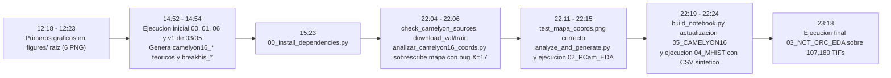
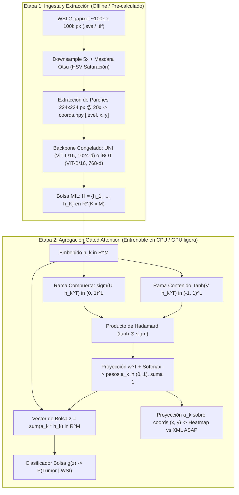
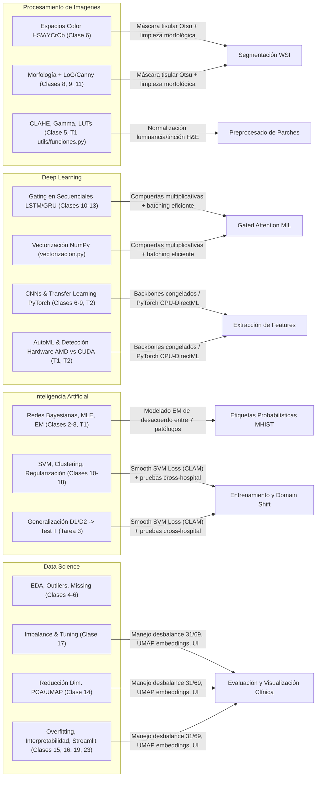

# 🔬 Análisis Profundo del Proyecto: Histopatología Digital & Multiple Instance Learning (MIL)

**Autor del Análisis:** Auditoría técnica integral del workspace `c:\Universidad\Magister\20 Noviembre Reunion`  
**Programa:** Magíster en Ciencias de la Computación — Universidad Diego Portales (UDP)  
**Estudiante:** Lucas Vicuña · **Profesor Guía:** Dr. Jorge Eduardo Zambrano Ibujés  
**Fecha:** 24 de noviembre de 2026 *(Reunión objetivo: 20 de noviembre de 2026)*

---

## 1. Visión General y Propósito Real del Workspace

El repositorio consolida la **etapa de exploración, selección, adquisición y auditoría de datos** para una tesis de Magíster centrada en **Multiple Instance Learning (MIL)** aplicado a **histopatología digital** (clasificación débilmente supervisada de cáncer de mama, metástasis en ganglio linfático axilar y cáncer/pólipos colorrectales).

El análisis transversal del código, salidas de ejecución, hardware detectado en `Materia Util` y la presentación previa (`Presentacion de ejemplo/`) revela cuatro pilares que definen el diseño del proyecto:

1. **Marco Teórico Central (Ilse et al., ICML 2018):** Transición del paradigma *Instance-Level* ($f(\mathbf{x}_k) \to p_k$) hacia *Embedding-Level* ($\mathbf{h}_k \in \mathbb{R}^M \to \mathbf{z} \in \mathbb{R}^M$) usando **Gated Attention** ($a_k \propto \exp(\mathbf{w}^\top(\tanh(\mathbf{V}\mathbf{h}_k^\top) \odot \text{sigm}(\mathbf{U}\mathbf{h}_k^\top)))$), su extensión multirrama con *Smooth SVM Clustering* (**CLAM**), y correlación espacial no-I.I.D. (**TransMIL**).
2. **Restricción de Almacenamiento (< 10 GB por dataset):** Viabilizar experimentos reproducibles sin descargar los ~700 GB crudos de WSIs completas de CAMELYON16 ni terabytes de TCGA.
3. **Restricción de Cómputo Local (Hardware Auditado):** Según la salida real capturada en `Materia Util/DEEP LEARNING/Tareas/T2/Tarea_2.ipynb`, la máquina de trabajo cuenta con **Windows, procesador AMD64 (Family 25 Model 117), GPU AMD Radeon RX 9060 XT y PyTorch `2.11.0+cpu` (`CUDA disponible: False`)**. Esto vuelve imprescindible el **pipeline desacoplado en dos etapas** (usar embeddings pre-extraídos con *Foundation Models* como `UNI` 1024-d o `iBOT` 768-d para entrenar únicamente el cabezal de atención $\mathcal{O}(K)$ en minutos).
4. **Integración Académica (`Materia Util/`):** Se adjuntan 4 ramos completos del Magíster (**Data Science**, **Deep Learning**, **Inteligencia Artificial** y **Procesamiento de Imágenes**) cuyas herramientas de código y teoría alimentan directamente las etapas de preprocesamiento, modelado, manejo de desbalance, evaluación multi-dominio e interpretabilidad.

---

## 2. Diagramas Estructurales y de Funcionamiento

### 2.1 Arquitectura Completa y Linaje de Artefactos (Qué produce qué)

```mermaid
flowchart TB
    subgraph EXT["Fuentes Externas y Datos Locales"]
        BK_EXT["C:/Universidad/Magister/Datasets/BreaKHis_v1 (7,909 PNG)"]
        ZEN_PCAM["Zenodo 2546921 (PCam HDF5 valid)"]
        ZEN_NCT["Zenodo 1214456 (NCT-CRC 100K + Val 7K)"]
        GH_MHIST["GitHub bmirds/mhist (annotations.csv)"]
        KAG_CAM["Kaggle / CAMELYON16 (Coords, XML, Patches .npy)"]
    end

    subgraph SCRIPTS["scripts/ (7 scripts)"]
        S_INST["00_install_dependencies.py"]
        S_CHK["check_camelyon_sources.py"]
        S_DVAL["download_val.py"]
        S_DTR["download_train.py"]
        S_AN["analyze_and_generate.py"]
        S_BLD["build_notebook.py"]
        S_CAM["analizar_camelyon16_coords.py"]
    end

    subgraph NB["notebooks/ (7 notebooks)"]
        N00["00_Resumen_Datasets_Histopatologia.ipynb"]
        N01["01_BreaKHis_EDA.ipynb"]
        N02["02_PCam_EDA.ipynb"]
        N03["03_NCT_CRC_EDA.ipynb"]
        N04["04_MHIST_EDA.ipynb"]
        N05["05_CAMELYON16_WSI.ipynb"]
        N06["06_Comparativa_Final.ipynb"]
    end

    subgraph DATA["data_samples/ (~27.4 GB)"]
        DP["pcam/ (864.1 MB)"]
        DN["nct_crc/ (15.19 GB | 107,180 .tif)"]
        DM["mhist/annotations.csv (0.08 MB)"]
        DC["camelyon16/coords/ (399 coords.npy)"]
        DMK["camelyon16/masks/ (111 XML + normal_map.xlsx)"]
        DPT["camelyon16/patches/ (25,235 .npy | 10.68 GB)"]
    end

    subgraph ART["Salidas: tablas/ (40 .xlsx) + figures/ (106 .png)"]
        T00["Comparativa, Criterios, Estrategias, Tiers (4 xlsx + 4 png)"]
        T01["BreaKHis (6 xlsx + 19 png)"]
        T02["PCam (5 xlsx + 21 png)"]
        T03["NCT-CRC (6 xlsx + 23 png)"]
        T04["MHIST (5 xlsx + 15 png)"]
        T05["CAMELYON16 (8 xlsx + 9 png + test_mapa_coords.png)"]
        T06["Comparativa Final (6 xlsx + 9 png)"]
    end

    BK_EXT --> N01 --> T01
    ZEN_PCAM --> DP --> N02 --> T02
    ZEN_NCT --> S_DVAL & S_DTR --> DN
    DN --> S_AN & N03 --> T03
    S_BLD -->|genera| N03
    GH_MHIST --> DM --> N04 --> T04
    KAG_CAM --> DC & DMK & DPT
    DC & DMK --> S_CAM & N05 --> T05
    N00 --> T00
    N06 --> T06
```

### 2.2 Flujo Temporal de Construcción e Incidencias (24 de Noviembre 2026)

### 2.3 Arquitectura Técnica de Deep MIL (De la WSI a la Atención con Compuertas)

### 2.4 Mapa de Sinergia: `Materia Util/` → Proyecto de Tesis MIL

---

## 3. Análisis Detallado Archivo por Archivo

### 3.1 Notebooks (`notebooks/`)

| Archivo | Tamaño | Celdas | Propósito y Funcionamiento Real | Salidas Generadas | Observaciones / Hallazgos |
| :--- | :---: | :---: | :--- | :--- | :--- |
| [`00_Resumen_Datasets_Histopatologia.ipynb`](../notebooks/00_Resumen_Datasets_Histopatologia.ipynb) | 336 KB | 21 | Catálogo comparativo de 8 datasets (`BreaKHis`, `PCam`, `NCT-CRC-HE-100K`, `MHIST`, `CAMELYON16`, `BACH`, `BRACS`, `DigestPath`). Gráfico scatter log-log (GB vs N° imágenes) con umbral 10 GB, gráfico radar de 5 criterios y clasificación en 3 Tiers. | `tablas/datasets_comparativa.xlsx`, `evaluacion_criterios_mil.xlsx`, `estrategias_descarga.xlsx`, `recomendacion_tiers.xlsx` + 4 PNGs en `figures/00_Resumen/` | Los datos son catálogos estáticos hardcodeados; difiere ligeramente de `06_Comparativa` en tamaños (`BreaKHis`: 7.9 GB aquí vs 4.27 GB en `06`) y asignación de Tiers. |
| [`01_BreaKHis_EDA.ipynb`](../notebooks/01_BreaKHis_EDA.ipynb) | 2.98 MB | 17 | Escanea recursivamente `C:\Universidad\Magister\Datasets\BreaKHis_v1` (7,909 PNGs de 700×460 px; 2,480 benignos / 5,429 malignos; 4 aumentos `40x/100x/200x/400x`; 8 subtipos). Calcula estadísticas RGB sobre muestra de 200 imágenes (`mean=[0.780, 0.635, 0.759]`, `std=[0.107, 0.137, 0.089]`) e intenta construir bolsas MIL por paciente. | 6 `.xlsx` (`breakhis_*`) + 19 PNGs en `figures/01_BreaKHis/` | **Bug crítico**: `paciente = tokens[1]` extrae el prefijo de año (`14` o `15`) de `SOB_B_A-14-22549AB-100-001.png` en vez de `tokens[1]+'-'+tokens[2]`, colapsando **82 pacientes reales en 2 bolsas** (`7,844` y `65` imgs). |
| [`02_PCam_EDA.ipynb`](../notebooks/02_PCam_EDA.ipynb) | 2.23 MB | 15 | Implementa descarga directa de Zenodo Record `2546921` (`camelyonpatch_level_2_split_valid_{x,y}.h5.gz`) evitando conflictos de `datasets`/`pyarrow`. Lee con `h5py` `(32768, 96, 96, 3) uint8` (16,399 Normal / 16,369 Tumor), visualiza el ROI diagnóstico central de `32×32 px` y calcula momentos RGB exactos por lotes (`Global mean=[0.6975, 0.5348, 0.6880]`, `std=[0.2361, 0.2786, 0.2146]`). | 5 `.xlsx` (`pcam_*`) + 21 PNGs en `figures/02_PCam/` | Notebook técnicamente sólido y 100% funcional en modo offline una vez descargado el HDF5. Muestra absorción diferencial del canal G en tejido tumoral (`0.4847` vs `0.5849` normal). |
| [`03_NCT_CRC_EDA.ipynb`](../notebooks/03_NCT_CRC_EDA.ipynb) | 3.23 MB | 17 | Escanea y analiza tanto `CRC-VAL-HE-7K` (7,180 `.tif`) como `NCT-CRC-HE-100K` (100,000 `.tif`), `224×224 px @ 20x`, 9 clases tisulares (`ADI, BACK, DEB, LYM, MUC, MUS, NORM, STR, TUM`). Compara proporciones Train vs Val y computa stats RGB sobre 300 muestras/clase. | 5 `.xlsx` (`nct_*`) + `nct_crc_distribucion.xlsx` previo + 23 PNGs en `figures/03_NCT_CRC/` | Generado programáticamente por `scripts/build_notebook.py` y ejecutado con éxito sobre los 107,180 archivos reales (`15.19 GB` en disco, mayor a los `8.5–11.7 GB` estimados). |
| [`04_MHIST_EDA.ipynb`](../notebooks/04_MHIST_EDA.ipynb) | 125 KB | 11 | Analiza `data_samples/mhist/annotations.csv` (3,152 filas, votos de 7 patólogos para `HP` vs `SSA`) y construye 100 pseudo-bolsas MIL (`K=20`, 44 positivas, 56 negativas) con `crear_bolsas_mhist()`. | 5 `.xlsx` (`mhist_*`) + 15 PNGs en `figures/04_MHIST/` | **Fallo grave de integridad de datos**: `annotations.csv` fue creado por la rama sintética `else:` (ver §4.2). No existen imágenes PNG descargadas en `data_samples/mhist/`. |
| [`05_CAMELYON16_WSI.ipynb`](../notebooks/05_CAMELYON16_WSI.ipynb) | 56 KB | 15 | Carga las 399 carpetas de `coords/CAMELYON16_FULL/*/coords.npy` (`3,177,267` parches `224×224`, `nivel=17`, `159 Normal / 110 Tumor / 130 Test`), reconstruye mapas espaciales (`Normal_076.tif` con 26,297 parches vs `tumor_092.tif` con 35,766 parches), parsea `tumor_001.xml` (2 polígonos, 855 y 1,657 vértices) y resume pipeline de 6 etapas (`iBOT`/`UNI`). | Outputs muestran 4 `.xlsx` + 2 figuras, pero en disco ver §4.3 | **Desfase entre notebook y disco**: 3 Excel citados en salida no existen en `tablas/`; el mapa en `figures/05_CAMELYON16/` tiene el bug del script previo; ignora los 25,235 `.npy` de `patches/`. |
| [`06_Comparativa_Final.ipynb`](../notebooks/06_Comparativa_Final.ipynb) | 553 KB | 17 | Consolida 10 datasets (añade `TCGA-BRCA` y `CAMELYON17`), genera figura compuesta de 4 paneles, radar de 6 ejes, hoja de ruta en 3 etapas (`~8.4 GB` adicionales), comandos CLI y código PyTorch/timm completo para extraer embeddings `[N, 1024]` con `hf-hub:MahmoodLab/UNI`. | 6 `.xlsx` (`datasets_maestra*`, `evaluacion_multidimensional`, `hoja_de_ruta`, `comandos_descarga`, `resumen_ejecutivo`) + 9 PNGs en `figures/06_Comparativa/` | Los emojis Unicode en títulos de Matplotlib renderizaron como cuadros (`□`) por fuente `DejaVu Sans` y hay leve solapamiento de leyenda en el panel inferior de `comparativa_final_completa.png`. |

### 3.2 Scripts (`scripts/`)

1. **`00_install_dependencies.py` (31 líneas):** Instala vía `pip` `gdown`, `tcia_utils`, `zenodo-get`, `h5py`, `requests`, `tqdm` y `openpyxl`.
2. **`check_camelyon_sources.py` (30 líneas):** Consulta la API de Zenodo (`records/7667205`) y lista datasets Kaggle candidatos (`andrewmvd/camelyon-patch-classification`, `histopathologiccancerdetection/...`).
3. **`download_val.py` (100 líneas) y `download_train.py` (103 líneas):** Descargadores HTTP con reanudación mediante cabecera `Range: bytes=...`, streaming por bloques (1 MB / 2 MB), barra `tqdm`, verificación de carpeta raíz dentro del `.zip` y eliminación automática del `.zip` post-extracción para ahorrar espacio.
4. **`analyze_and_generate.py` (332 líneas):** Script autónomo equivalente al núcleo analítico de `03_NCT_CRC_EDA.ipynb` (escaneo de 107,180 `.tif`, tablas Excel y gráficos RGB/distribución).
5. **`build_notebook.py` (513 líneas):** Generador programático con `nbformat` que construyó `notebooks/03_NCT_CRC_EDA.ipynb` con celdas de código y documentación estructurada (`📌 ¿Qué hace?`, `⚙️ ¿Cómo funciona?`).
6. **`analizar_camelyon16_coords.py` (174 líneas):** Script previo (22:06) que analizó `CAMELYON16_FULL` y las 111 máscaras XML, pero introdujo el bug de leer `coords[:, 0]` (`17`) como coordenada X.

### 3.3 Activos de Datos en `data_samples/` (~27.4 GB)

| Subcarpeta | Contenido Exacto Verificado | Tamaño en Disco | Estado en Notebooks |
| :--- | :--- | :---: | :--- |
| `pcam/` | `camelyonpatch_level_2_split_valid_x.h5` (906,040,528 B) + `_y.h5` (34,816 B) | 864.10 MB | Analizado completamente en `02_PCam_EDA.ipynb` |
| `nct_crc/NCT-CRC-HE-100K/` | 100,000 `.tif` en 9 subcarpetas (`TUM`: 14,317; `MUS`: 13,536; `LYM`: 11,557; `DEB`: 11,512; `BACK`: 10,566; `STR`: 10,446; `ADI`: 10,407; `MUC`: 8,896; `NORM`: 8,763) | ~14.44 GB | Analizado completamente en `03_NCT_CRC_EDA.ipynb` |
| `nct_crc/CRC-VAL-HE-7K/` | 7,180 `.tif` en 9 subcarpetas (`ADI`: 1,338; `TUM`: 1,233; `MUC`: 1,035; `BACK`: 847; `NORM`: 741; `LYM`: 634; `MUS`: 592; `STR`: 421; `DEB`: 339) | ~0.75 GB | Analizado completamente en `03_NCT_CRC_EDA.ipynb` |
| `camelyon16/coords/CAMELYON16_FULL/` | 399 carpetas (`Normal_001..160` excepto `Normal_144`; `Tumor_001..070` + `tumor_071..110`; `Test_001..130`), cada una con `coords.npy` (`float32`, `(N, 3)`) | 36.41 MB | Analizado en `05_CAMELYON16_WSI.ipynb` |
| `camelyon16/masks/` | 111 archivos XML ASAP (`tumor_001.xml`..`tumor_111.xml`) + `normal_map.xlsx` (160 filas mapeando IDs `1..160` a valores `1..12`) | 55.84 MB | XMLs contados en `05`; `normal_map.xlsx` sin usar |
| `camelyon16/patches/data/` | **25,235 `.npy`** (`shape=(), dtype=object` con diccionario `{'image': (256,256,3) uint8, 'mask': (256,256)}`): `classifier/train` (10,997), `classifier/val` (1,647), `test` (2,585 a Level 3), `unet` (10,006) | **10.68 GB** (10,935.73 MB) | **Completamente sin documentar ni usar** en ningún notebook o script |
| `mhist/` | Solo `annotations.csv` (88,378 B, 3,152 filas) | 0.08 MB | **Corrupto/Sintético** (ver §4.2) |

### 3.4 Tablas (`tablas/` - 40 `.xlsx`), Figuras (`figures/` - 106 `.png`) y Carpetas Auxiliares

- **`tablas/` (40 archivos, 686 KB):** Almacenan salidas tabulares de todos los EDA (metadatos, distribuciones, stats RGB, comparativas, hoja de ruta y comandos).
- **`figures/` (106 archivos, 28.18 MB):** Contienen 6 gráficos heredados en la raíz (12:18–12:23) más 7 subcarpetas por notebook (`00_Resumen` a `06_Comparativa`) con figuras combinadas y paneles individuales descompuestos mediante `guardar_subplots_individuales(..., dpi=150)`.
- **`informe/`:** Actualmente **vacía** (el `README.md` original indicaba `Informe LaTeX + PPT (próxima reunión)`).
- **`Presentacion de ejemplo/`:** Contiene `presentaci_n_interactiva_mag_ster_gated_attention_y_el_departamento_de_detectives.html` (16 diapositivas interactivas con Tailwind, KaTeX, Lucide Icons, simulador numérico de Hadamard y teleprompter para el orador), que define el estándar visual e institucional para el presente entregable.

---

## 4. Auditoría Técnica: Bugs y Discrepancias Críticas

### 4.1 Bug de Parsing de Pacientes en BreaKHis (`01_BreaKHis_EDA.ipynb`)
- **Ubicación:** Celda 5, función `cargar_metadata_breakhis()`.
- **Causa:** Para el archivo `SOB_B_A-14-22549AB-100-001.png`, `nombre.split('-')` produce `['SOB_B_A', '14', '22549AB', '100', '001']`. El código toma `paciente = tokens[1]` (`'14'`), ignorando `tokens[2]` (`'22549AB'`).
- **Impacto:** `breakhis_bags_pacientes.xlsx` agrupa **7,909 imágenes en solo 2 bolsas** (`14`: 7,844 imágenes y `15`: 65 imágenes) en vez de los **82 pacientes reales**. Si se entrenara MIL con esa tabla, habría *data leakage* y solo 2 bolsas de entrenamiento.
- **Corrección:** `paciente = f"{tokens[1]}-{tokens[2]}"` (o usar el nombre de la carpeta padre del aumento, ej. `SOB_B_A_14-22549AB`).

### 4.2 Anomalía Crítica en MHIST (`data_samples/mhist/annotations.csv` y `04_MHIST_EDA.ipynb`)
- **Evidencia observada directamente en `annotations.csv` y `tablas/mhist_*.xlsx`:**
  - Los nombres de imagen siguen la fórmula sintética del bloque `else:` de `04_MHIST_EDA.ipynb`: `MHIST_A00.png` hasta `MHIST_\`51.png` (donde `` ` `` es `chr(65 + 31)`).
  - La columna `Majority Vote Label` tiene 2,162 `HP` seguidos de 990 `SSA`, y `Partition` tiene 2,175 `train` seguidos de 977 `test`. Resultado en `mhist_estadisticas_clases.xlsx`: **`train` tiene 2,162 HP (99.4%) y 13 SSA (0.6%); `test` tiene 0 HP (0%) y 977 SSA (100%)**.
  - Los votos (`Number of Pathologists Voting HP` y `SSA`) son enteros aleatorios independientes entre 1 y 7 que no suman 7 y contradicen la etiqueta (ej. `MHIST_A00.png`: Label=`HP`, votos HP=3, votos SSA=6).
  - Visualmente, en `figures/04_MHIST/mhist_muestras_hp_vs_ssa.png`, el gráfico de violín muestra distribuciones idénticas para HP y SSA y barras de split completamente invertidas.
- **Corrección:** Eliminar `annotations.csv` sintético, descargar el `annotations.csv` oficial de `bmirds/mhist` e `images.zip` (333 MB), y regenerar `04_MHIST_EDA.ipynb` + `mhist_*.xlsx`.

### 4.3 Desfase de Coordenadas y Artefactos en CAMELYON16 (`05_CAMELYON16_WSI.ipynb` vs `analizar_camelyon16_coords.py`)
- **Causa:** Cada `coords.npy` tiene forma `(N, 3)` con columnas `[level, x, y]` donde la columna `0` vale constantemente `17`.
  - `scripts/analizar_camelyon16_coords.py` (22:06) graficó `coords[:, 0]` vs `coords[:, 1]`, generando en `figures/05_CAMELYON16/camelyon16_mapa_coords.png` dos líneas verticales en `X=17.0` y guardando `Coord_Min_X=17, Coord_Max_X=17` en `tablas/camelyon16_coords_por_wsi.xlsx`.
  - `05_CAMELYON16_WSI.ipynb` corrige la indexación (`coords[:, 1]` vs `coords[:, 2]`, produciendo el mapa correcto visible en `notebooks/test_mapa_coords.png`), pero sus tablas (`camelyon16_coordenadas_extremos.xlsx`, `camelyon16_pipeline_mil.xlsx`, `camelyon16_estrategia_mil.xlsx`) nunca quedaron persistidas en `tablas/` y `figures/05_CAMELYON16/camelyon16_mapa_coords.png` sigue mostrando el gráfico erróneo de `X=17`.
- **Hallazgo adicional:** `Normal_144.tif` no está en `CAMELYON16_FULL` (por eso hay 159 Normales + 110 Tumorales + 130 Test = 399 WSIs), mientras que `masks/lesion_annotations/` tiene 111 XMLs (`tumor_001.xml` a `tumor_111.xml`) y `masks/normal_map.xlsx` tiene 160 filas.

### 4.4 Desalineaciones Menores entre Resumen (`00`) y Comparativa Final (`06`)
- **Volumen real vs. presupuesto:** Los notebooks declaran `~8.4 GB` acumulados y un límite `<10 GB` por dataset, pero `data_samples/` ya ocupa **27.4 GB** (`nct_crc`: 15.19 GB; `camelyon16/patches`: 10.68 GB).
- **Inconsistencia de Tiers y tamaños:** `00_Resumen` lista `BreaKHis = 7.9 GB` y `PCam` en Tier 1 / `NCT-CRC` en Tier 2; `06_Comparativa` lista `BreaKHis = 4.27 GB` y `NCT-CRC` + `MHIST` en Tier 1 / `PCam` en Tier 2.

---

## 5. Cruce Técnico Detallado con `Materia Util/`

El directorio `Materia Util/` (~5.16 GB, 4 ramos) contiene código reutilizable y teoría directamente aplicable a cada cuello de botella de este proyecto:

### 5.1 Procesamiento de Imágenes (`Materia Util/PROCESAMIENTO DE IMAGENES/`)
- **Segmentación tisular robusta:** Combinando `Clase 6 Espacios de Color.pdf` (conversión RGB → HSV / YCrCb) con `Clase 11 Operaciones Morfológicas` (`10_procesamiento_morfologico_1.2.pdf`), se puede implementar la máscara Otsu del canal S de CAMELYON16 seguida de apertura/cierre morfológico para eliminar polvo/artefactos sin perder micro-metástasis periféricas.
- **Normalización de tinción y contraste H&E:** En `Tarea 1/utils/funciones.py` están ya implementadas en OpenCV/NumPy funciones modulares (`gamma_transformation`, `estiramiento_min_max`, `estiramiento_lo_hi`, `ecualizacion_histograma`, `ecualizacion_clahe`) con soporte selectivo sobre el canal de luminancia `Y` en `YCrCb` (`bgr=False`) para no distorsionar los matices cromáticos de Hematoxilina y Eosina.
- **Extracción clásica de descriptores complementarios:** `Clase 8-9` (Sobel, Laplaciano, LoG, Canny) y `Clase 14` (puntos de interés y descriptores) sirven para diagnosticar bordes nucleares y validar visualmente regiones de alta densidad celular junto con los mapas de calor de atención.

### 5.2 Deep Learning (`Materia Util/DEEP LEARNING/`)
- **Vectorización y rendimiento (`Redes Neuronales profundas/vectorizacion.py`):** Demuestra mediante `time.perf_counter()` las aceleraciones obtenidas al vectorizar operaciones con NumPy frente a bucles, base indispensable al manipular `3,177,267` coordenadas o lotes HDF5 de PCam.
- **Transfer Learning y profiling de hardware (`Tareas/T2/Tarea_2.ipynb`):** Implementa un pipeline PyTorch completo con `mobilenet_v2`, `resnet50` y `googlenet`, y confirma que en el equipo local (**AMD RX 9060 XT + PyTorch CPU**) el entrenamiento de backbones pesados sobre imágenes crudas es lento sin aceleración CUDA — justificando plenamente descargar embeddings precalculados (`UNI` / `iBOT`) o evaluar `torch-directml` / `ROCm`.
- **Fundamentos de compuertas (`Redes secuenciales/Clases 10-13`):** Las compuertas multiplicativas sigmoide $\odot \tanh$ de LSTM/GRU son la inspiración directa de la Ecuación (6) de **Gated Attention** en Ilse et al. (2018).
- **Tuning de arquitecturas (`Tareas/T1/models/automl_model.py`):** El patrón de búsqueda de hiperparámetros (`units`, `dropout`, `learning_rate`) es transferible al ajuste de los MLP proyectores ($V, U, w$) y clasificador de bolsa $g(\mathbf{z})$ sobre embeddings tabulares de 768/1024 dimensiones.

### 5.3 Inteligencia Artificial (`Materia Util/Inteligencia_Artificial/`)
- **Manejo de incertidumbre y consenso médico (`Métodos probabilísticos/Clases 2-8`, `Tarea_1`):** Los algoritmos **MLE** y **Expectation-Maximization (EM)** y las Redes Bayesianas permiten modelar la confiabilidad latente de los 7 patólogos en MHIST en lugar de reducir los votos a una etiqueta dura binaria.
- **Clasificadores de margen máximo y regularización (`Machine Learning/Clases 14-18`):** La formulación de **SVM** fundamenta la *Smooth Top-1 SVM Loss* que utiliza **CLAM** sobre los parches con mayor y menor atención $a_k$.
- **Validación de cambio de dominio (`Tareas/Tarea_3/Tarea_3.ipynb`):** El protocolo experimental de entrenar una CNN en un dominio `D1`, luego en `D2` y evaluar ambas en un dominio externo `T` es exactamente el diseño experimental necesario para medir *stain/hospital domain shift* entre `NCT-CRC-HE-100K` → `CRC-VAL-HE-7K`, o `CAMELYON16` → `PCam`/`BreaKHis`.

### 5.4 Data Science (`Materia Util/DATA_SCIENCE/`)
- **Desbalance de clases y ajuste de hiperparámetros (`Clase 17`):** Crucial para BreaKHis (31.4% vs 68.6%, con `ductal_carcinoma` acaparando 3,451 muestras) y bolsas con baja carga tumoral en CAMELYON16 (<1% de parches positivos por WSI).
- **Reducción dimensional (`Clase 14`):** Aplicación directa de PCA / t-SNE / UMAP sobre los vectores latentes de `UNI` (1024-d) o `iBOT` (768-d) para verificar separabilidad de tejidos antes del pooling MIL.
- **Overfitting, Regularización e Interpretabilidad (`Clases 15, 16, 19`):** Previene el sobreajuste en conjuntos con pocas bolsas ($N=82$ pacientes en BreaKHis, $N=269$ WSIs de train en CAMELYON16) y conecta los pesos de atención $a_k$ con técnicas formales de atribución.
- **Despliegue de dashboards (`Clase 23 Streamlit`, `Proyecto-Final-data-science-main`):** Base práctica para construir un visor clínico interactivo de bolsas MIL y mapas de calor histopatológicos.

---

## 6. Recomendaciones Accionables y Próximos Pasos

1. **Corregir inmediatamente los 3 bugs de datos/scripts:**
   - Arreglar `tokens[1] + '-' + tokens[2]` en `01_BreaKHis_EDA.ipynb` para recuperar las 82 bolsas de pacientes reales.
   - Reemplazar `data_samples/mhist/annotations.csv` por el archivo oficial de `bmirds/mhist` y descargar `images.zip` (333 MB).
   - Re-ejecutar `05_CAMELYON16_WSI.ipynb` para persistir en `tablas/` y `figures/05_CAMELYON16/` el mapa 2D correcto (`coords[:, 1]` vs `coords[:, 2]`) y corregir o retirar `scripts/analizar_camelyon16_coords.py`.
2. **Auditar e indexar `data_samples/camelyon16/patches/` (10.68 GB):** Verificar si estos 25,235 `.npy` (`256×256` con `'image'` y `'mask'`) cubren el prototipado de entrenamiento/segmentación U-Net o si deben archivarse fuera del directorio de trabajo para liberar espacio si se opta por los embeddings `iBOT` (4.3 GB) o `UNI` (1.5 GB).
3. **Implementar el primer Baseline MIL (`Gated Attention`):** Crear un notebook `07_Baseline_Gated_Attention_MIL.ipynb` usando embeddings precalculados de `CAMELYON16` (o features extraídos de `BreaKHis` a 82 bolsas reales) comparando `Mean-Pooling`, `Max-Pooling`, `Plain Attention` y `Gated Attention` con métricas `ROC-AUC`, `F1-Score` y visualización de mapas de calor superpuestos a los XMLs de `lesion_annotations/`.
