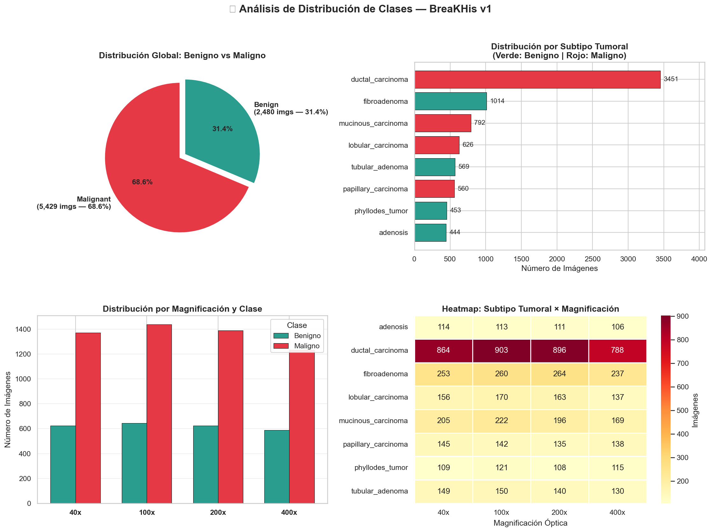
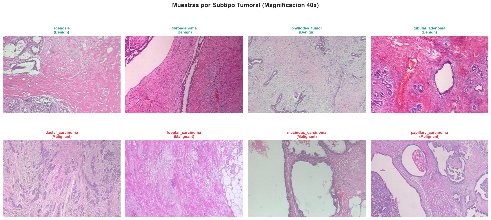
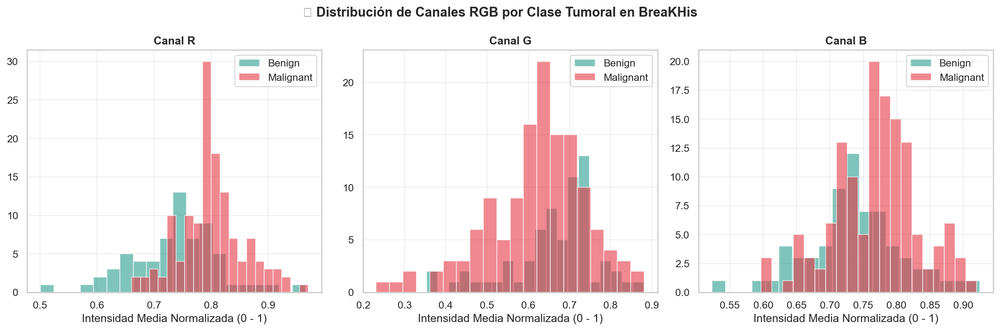

# Informe Guía de Exposición — Dataset 01: BreaKHis v1

> **Guía del Expositor &mdash; Magíster en Ciencias de la Computación (UDP)**  
> **Estudiante:** Lucas Vicuña (`Petucode`) &bull; **Profesor Guía:** Dr. Jorge Eduardo Zambrano Ibujés  
> **Notebook Asociado:** [`01_BreaKHis_EDA.ipynb`](../../notebooks/01_BreaKHis_EDA.ipynb) &bull; **Presentación HTML:** [`01_breakhis.html`](../datasets/01_breakhis.html)

---

## 1. Objetivo del Dataset y Rol en la Tesis de Magíster

BreaKHis v1 (Spanhol et al., IEEE TBME 2016) es nuestro **banco de prototipado rápido de Etapa 1** (ya presente en disco con 3.99 GB extraídos / 4.27 GB `.tar.gz`, sin descargas adicionales) y el **banco experimental central propuesto en el Seminario I (25 de Septiembre)**. A diferencia de las WSI gigapíxel de CAMELYON16, cada imagen PNG de BreaKHis mide **700 × 460 píxeles**, lo que permite validar la hipótesis central de la tesis: *¿pueden las sub-regiones de mapas de activación intermedios (obtenidos en un único pase truncado por una CNN pre-entrenada) sustituir el recorte costoso en espacio de píxeles?*

- **Volumen verificado en disco:** 7,909 imágenes RGB PNG sin compresión (`700 × 460 px`), capturadas con microscopio Olympus BX-50 (lente relé 3.3× + cámara CCD SCC-131AN, recortadas de 752×582 px para quitar bordes negros y anotaciones).
- **Distribución de clases:** 2,480 Benignas (**31.4%**) y 5,429 Malignas (**68.6%**), repartidas en 8 subtipos histológicos y 4 factores de aumento (`40x`: 1,995; `100x`: 2,081; `200x`: 2,013; `400x`: 1,820).
- **Utilitario doble en MIL:** Permite formular bolsas tanto a nivel de **Paciente = Bolsa** (81 bolsas reales, promedio ~97.6 imágenes/paciente) como de **Imagen = Bolsa** (K sub-regiones del mapa de activación intermedio).

## 2. Cómo Explicarlo en la Reunión ('Con Peras y Manzanas')

Use la analogía del **álbum fotográfico de 4 lentes para el mismo bosque**: tomar 4 fotos distintas (a 40x panorámica, 100x, 200x y 400x detalle) del mismo árbol sigue siendo **el mismo árbol**. Si un estudiante de medicina estudia la foto de 40x del Sr. Pérez y en el examen final le muestran la foto de 400x del **mismo Sr. Pérez**, puede memorizar el color de la tinción o la textura del paciente en lugar de aprender qué es un carcinoma. Ese error metodológico se llama **data leakage por paciente**.

## 3. Qué Hizo Exactamente Nuestro Notebook `01_BreaKHis_EDA.ipynb` + Bug Auditado

El notebook ejecuta 5 bloques reproducibles sobre el directorio local `BreaKHis_v1/histology_slides/breast/`, generando 6 archivos Excel en `tablas/` y 3 figuras compuestas (15 paneles individuales) en `figures/01_BreaKHis/`.

| Etapa del Código | Operación Realizada | Artefacto Generado | Hallazgo / Auditoría |
| :--- | :--- | :--- | :--- |
| 1. Exploración árbol | Recorre `benign` / `malignant` / `SOB` y verifica tamaño real en disco. | `breakhis_resumen_informe.xlsx` | Harmonizado a `3.99 GB` extraído (`4.27 GB .tar.gz`), corrigiendo error antiguo de `7.9 GB`. |
| 2. Parser de metadata | Parsea nombres `SOB_B_A-14-22549AB-100-001.png` en 7,909 filas. | `breakhis_metadata.xlsx` | **Bug Crítico #1 resuelto:** `tokens[1]` truncaba a `'14'` (2 pacientes). Arreglado a `tokens[1]-tokens[2]`. |
| 3. Tablas pivote y distribución | Cruza 8 subtipos &times; 4 aumentos y exporta conteos. | `breakhis_pivot_subtipo_magnificacion.xlsx` | Confirma dominancia de Ductal (3,451 = 43.6%) y Fibroadenoma como mayor subtipo benigno (1,014). |
| 4. Estadística espectral RGB | Muestrea 200 imágenes, valida forma `(460,700,3)` y media/std. | `breakhis_stats_pixeles.xlsx` | Media muestral `[0.780, 0.635, 0.759]`; `mean_G` cae hasta `0.319` en carcinomas densos por hematoxilina. |
| 5. Construcción de Bolsas MIL | Agrupa por `paciente` real y por `carpeta_clinica`. | `breakhis_bags_pacientes.xlsx` | Revela **81 pacientes únicos en 82 carpetas** porque el paciente **`14-13412`** tiene biopsias DC y LC. |

## 4. Ejemplos Numéricos Concretos de Nuestras Tablas (`tablas/`)

- **Caso de cruce multi-carpeta (`breakhis_bags_pacientes.xlsx`):** El paciente **`14-13412`** totaliza **246 imágenes** repartidas en las 4 magnificaciones (`40, 100, 200, 400`), pero abarca **dos carpetas clínicas distintas**: `ductal_carcinoma` y `lobular_carcinoma`. Si hubiéramos usado el nombre de carpeta como grupo, ¡habríamos partido al mismo paciente en dos!
- **Bolsa mínima vs máxima observada en muestra (`Bags_Pacientes`):** `14-10926` aporta **39 imágenes** (todas DC), mientras `14-13412` aporta **246 imágenes**, y en benignos `14-15275` tiene **53** vs `14-21998AB` (`phyllodes_tumor`) con **235 imágenes**.
- **Evidencia cromática H&E (`breakhis_stats_pixeles.xlsx`):** Mientras una lámina clara de `tubular_adenoma (100x)` registra `mean_G = 0.851`, una lámina densa de `ductal_carcinoma (200x)` cae a `mean_G = 0.319` — exactamente la firma de absorción nuclear por Hematoxilina.

## 5. Relación Directa con Reuniones Previas y Papers de `Referencias/`

- **Seminario 25 de Septiembre (`Magister_25SEP.pdf` & `4.metodologia.tex`):** Define BreaKHis como validación principal para probar representaciones de **capas intermedias** con pesos congelados (ResNet-18, ResNet-50, EfficientNet-B0) evaluadas con partición por paciente y AUC con intervalos bootstrap 95%. Note que ahí se citaban 82 pacientes por convención de Spanhol: nuestra auditoría explica el porqué exacto (`81 IDs` en `82 carpetas`).
- **Zambrano et al. (IEEE Access 2022, Prof. Guía):** Demuestra en biometría sin fine-tuning que las **primeras ≤33% de capas convolucionales** (`DenseNet201 conv3_block8_concat` al 14%, `ResNet50 res3b_branch2c` al 33%, `InceptionV3 conv2d_25` al 27%) codifican patrones locales de textura fina mejor que las capas finales sesgadas hacia objetos macroscópicos de ImageNet, reduciendo el tiempo de extracción hasta **59.33%**. En BreaKHis (`700×460 px`), eso permite pasar la foto **una vez** y usar la rejilla espacial intermedia como instancias MIL.
- **Spanhol et al. (IEEE TBME 2016):** Establece el protocolo 70/30 estratificado por paciente (5 repeticiones), obtiene `80%–85.1%` con PFTAS (162-d) + SVM @ 200x (`AUC = 0.861`), y documenta en su **Tabla VIII** que ~**30% de todos los errores** son tumores benignos **Fibroadenoma** clasificados falsamente como malignos.
- **Sudharshan et al. (ESWA 2019 — Baseline MIL directo en BreaKHis):** Recorta parches `64×64` con descriptores PFTAS (`1,000` aleatorios en train, `~100` en test por imagen &rarr; `~2,500` por paciente-bolsa). Compara 12 variantes MIL: obtiene **92.1% ± 5.9%** a `40x` con Non-parametric MIL (vs **86.9% ± 5.4%** MILCNN) cuando usa **Patient as bag**, bajando a `80.8%–87.8%` en *Image as bag*, y probando estadísticamente que `MI-SVM` supera a `mi-SVM` (`p = 0.0029`).
- **Puente con 08 Oct & 09 Nov (`Ilse 2018` + `Lu 2021 CLAM`):** Reemplazar los vectores artesanales PFTAS de Sudharshan por embeddings intermedios + **Gated Attention** ($\tanh(Vh_k^\top) \odot \sigma(Uh_k^\top)$) permite ponderar las regiones más diagnósticas e interpretar qué zonas dispararon una predicción de Fibroadenoma vs Carcinoma Ductal.

## Preguntas Probables del Prof. Zambrano (Defensa Oral)

### 1. ¿Por qué tu informe de Septiembre decía 82 pacientes y ahora muestras 81?
> En Spanhol et al. (2016) hay 82 carpetas clínicas en disco (24 benignas + 58 malignas), por eso toda la literatura cita 82. Al parsear el ID real del paciente `14-XXXXX` en todas las 7,909 imágenes descubrimos que `14-13412` aparece simultáneamente en Ductal Carcinoma y Lobular Carcinoma (246 imágenes). Usar el ID único de 81 pacientes evita cualquier fuga al particionar.

### 2. ¿Cuál es la ganancia científica concreta frente a Sudharshan et al. (2019)?
> Sudharshan extrajo manualmente 1,000 parches de 64×64 por imagen con textura artesanal PFTAS (162-d) o re-entrenó una CNN pequeña por parche. Nosotros conservamos el mismo protocolo estricto por paciente, pero extraemos sub-regiones directamente desde mapas intermedios (≤33% de profundidad según Zambrano 2022) en un único pase por imagen y las agregamos con Gated Attention (Ilse 2018), ganando eficiencia computacional y mapas espaciales interpretables.

### 3. Si Fibroadenoma causa el 30% de falsos positivos en Spanhol, ¿qué podemos hacer?
> Reportar matriz de confusión por subtipo y usar Gated Attention + normalización de tinción o características SSL de dominio médico (como sugiere Kang et al., CVPR 2023), observando en los mapas de calor qué regiones inducen al error frente a Ductal Carcinoma.

---
*Generado y auditado sobre cifras verificadas del repositorio (`01_BreaKHis_EDA.ipynb` y libros `tablas/*.xlsx`). [Volver a la Presentación HTML](../datasets/01_breakhis.html) &bull; [Presentación Central 20 Nov](../presentacion_reunion_20_noviembre.html)*
