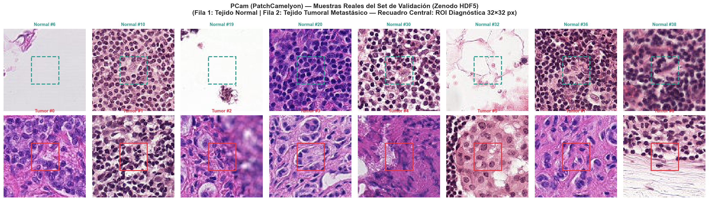

# Informe Guía de Exposición — Dataset 02: PatchCamelyon (PCam)

> **Guía del Expositor &mdash; Magíster en Ciencias de la Computación (UDP)**  
> **Estudiante:** Lucas Vicuña (`Petucode`) &bull; **Profesor Guía:** Dr. Jorge Eduardo Zambrano Ibujés  
> **Notebook Asociado:** [`02_PCam_EDA.ipynb`](../../notebooks/02_PCam_EDA.ipynb) &bull; **Presentación HTML:** [`02_pcam.html`](../datasets/02_pcam.html)

---

## 1. Resumen Ejecutivo y Papel de PCam en la Tesis

**PatchCamelyon (PCam)** (Veeling et al., MICCAI 2018) extrae recuadro por recuadro **327,680 parches (`96 × 96 px`)** desde 400 WSIs de CAMELYON16. En nuestro disco ya está descargado completamente el **split oficial de Validación (`864.10 MB` en HDF5)** con **32,768 parches** balanceados al ~50/50. Su papel es actuar como puente rápido entre representaciones locales a nivel de parche y la gran escala WSI.

## 2. La Regla 'Con Peras y Manzanas': La Mirilla 32×32 dentro del 96×96

Cada recorte PCam mide `96 × 96` px, pero su etiqueta binaria (`0` Normal, `1` Tumor) se asigna **solo si la región central de `32 × 32` píxeles (11.1% del área) contiene al menos un píxel tumoral anotado**. El resto forma un marco contextual de 32 px alrededor para evitar recortes ciegos en bordes celulares.

## 3. Lo Que Hizo `02_PCam_EDA.ipynb` + Ejemplos Reales de Datos

| Paso en Notebook 02 | Archivo Leído / Generado | Resultado Auditado Verificado |
| :--- | :--- | :--- |
| Descarga HDF5 Zenodo 2546921 | `camelyonpatch_level_2_split_valid_x.h5` / `_y.h5` | 864.0 MB (`x`) + 0.1 MB (`y`), lectura instantánea por bloques sin 32k PNG sueltos. |
| Conteo Clases Split Val | `pcam_distribucion_classes.xlsx` | **16,399 Normal (50.05%)** y **16,369 Tumor (49.95%)** sobre exactamente 32,768 parches. |
| Estadísticas RGB Exactas (100%) | `pcam_estadisticas_reales.xlsx` | Global: `R=0.6975, G=0.5348, B=0.6880` (`177.9, 136.4, 175.4` en 0–255). |
| Diferencia Física Tumor vs Normal | `pcam_muestras_reales.png` | El canal Verde cae **&minus;0.1002** (`0.5849` Normal &rarr; `0.4847` Tumor) por absorción nuclear de Hematoxilina. |

## 4. Conexión con Reuniones Previas y Papers Clave (`Referencias/`)

- **Reunión 25 de Septiembre (Capas Intermedias):** El Seminario I incluyó explícitamente a PCam (`96×96`) como alternativa compacta que permite pase único con extractores congelados. Aquí podemos probar comparando la última capa ImageNet vs la capa intermedia 33% propuesta en **Zambrano et al. (2022)**.
- **Kang et al. (CVPR 2023 — *Benchmarking SSL on Diverse Pathology Datasets*):** Evalúa directamente sobre los 327,680 parches de PCam (Tabla 3). Con pesos congelados (*Linear Evaluation*), **ResNet-50 supervisada en ImageNet obtiene solo 80.79%**, mientras **Barlow Twins SSL sobre TCGA sube a 88.15%** y **ViT-S DINO (p=8) alcanza 90.12%** (+9.33 puntos!). Además demuestra que pre-entrenar con aumentos mixtos `20x + 40x` supera al `40x` aislado en PCam (`86.92%` vs `80.82%`).
- **Reuniones 08 Oct & 09 Nov (Pseudo-Bags MIL):** Agrupar aleatoriamente subconjuntos de nuestros 32,768 parches reales en bolsas sintéticas (ej. 1 parche tumoral entre 49 normales = 2% de concentración) replica el escenario clínico de micrometástasis en CAMELYON16.

## Preguntas Probables del Prof. Zambrano (Defensa Oral)

### 1. ¿PCam sirve directamente para MIL si ya viene recortado en parches de 96×96?
> No viene agrupado por paciente de fábrica como BreaKHis ni como WSI completa, sino como catálogo limpio de instancias `96×96`. Su valor es doble: (1) probar en minutos qué capas intermedias o backbones SSL separan mejor tumor vs sano, y (2) ensamblar Pseudo-Bolsas controladas con fracciones bajas de tumor (1%–5%) para verificar Gated Attention antes de pasar a las 399 láminas de CAMELYON16.

### 2. ¿Por qué cayó justo el canal Verde entre Normal y Tumor en `pcam_estadisticas_reales.xlsx`?
> En tinción H&E, la Eosina tiñe el tejido conectivo/citoplasma de rosado (luz roja/azul alta), mientras que la Hematoxilina tiñe los núcleos basófilos de azul oscuro/morado, absorbiendo fuertemente longitudes de onda verdes (~540 nm). Los tumores tienen núcleos grandes y densos, bajando la reflectancia media verde de 149.1 a 123.6.

---
*Generado y auditado sobre cifras verificadas del repositorio (`02_PCam_EDA.ipynb` y libros `tablas/*.xlsx`). [Volver a la Presentación HTML](../datasets/02_pcam.html) &bull; [Presentación Central 20 Nov](../presentacion_reunion_20_noviembre.html)*
