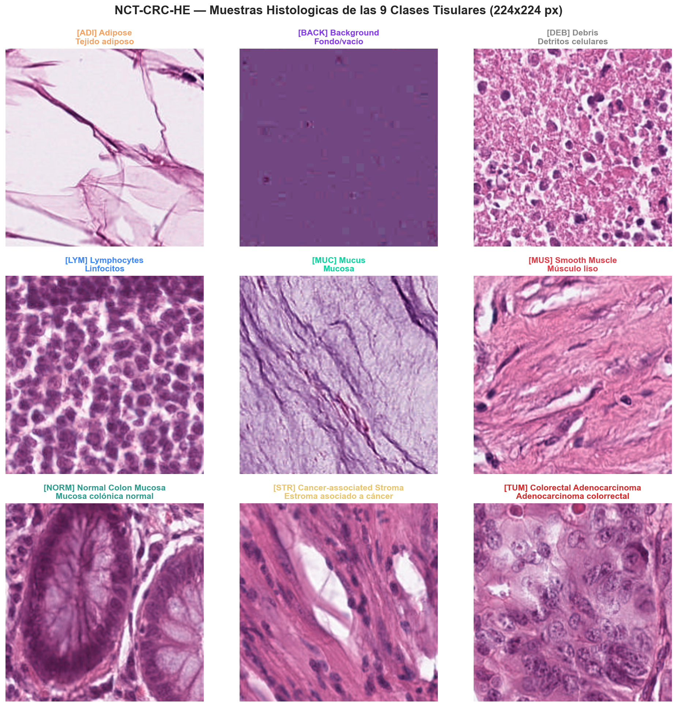
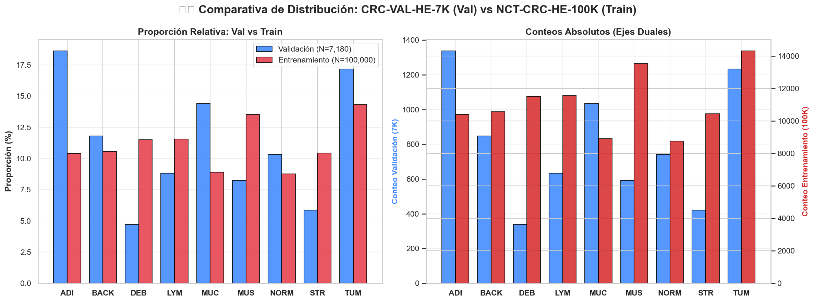

# Informe Guía de Exposición — Dataset 03: NCT-CRC-HE (107,180 Parches)

> **Guía del Expositor &mdash; Magíster en Ciencias de la Computación (UDP)**  
> **Estudiante:** Lucas Vicuña (`Petucode`) &bull; **Profesor Guía:** Dr. Jorge Eduardo Zambrano Ibujés  
> **Notebook Asociado:** [`03_NCT_CRC_EDA.ipynb`](../../notebooks/03_NCT_CRC_EDA.ipynb) &bull; **Presentación HTML:** [`03_nct_crc.html`](../datasets/03_nct_crc.html)

---

## 1. Objetivo Estratégico y Alcance Real en Disco

**NCT-CRC-HE-100K & CRC-VAL-HE-7K** (Kather et al., 2018) se encuentra **descargado al 100% en nuestro equipo** (`15.19 GB` totales: `14.44 GB` de entrenamiento con 100,000 parches + `0.75 GB` de validación externa con 7,180 parches de 50 pacientes independientes). A diferencia de datasets binarios puros, descompone la histología en **9 categorías tisulares** a resolución `224 × 224 px @ 20x`.

## 2. Explicación 'Con Peras y Manzanas'

Un tumor en un paciente real nunca flota aislado en vidrio transparente: convive rodeado de grasa (`ADI`), músculo liso (`MUS`), mucosa (`MUC`), fibra cicatricial estromal (`STR`) y células inmunes azuladas (`LYM`). Enseñar esos 9 tejidos permite a una red MIL aprender qué texturas son ruido de fondo normal (aunque sean oscuras como `LYM` o `DEB`) y no confundirlas con adenocarcinoma (`TUM`).

## 3. Flujo Técnico de `03_NCT_CRC_EDA.ipynb` + Ejemplos Cuantitativos

| Archivo Excel Generado | Contenido Medido | Cifra Concreta Auditada |
| :--- | :--- | :--- |
| `nct_train_distribucion_real.xlsx` | Conteo 9 clases Train | Total `100,000`: mayor `TUM (14,317 / 14.32%)`, menor `NORM (8,763 / 8.76%)`. |
| `nct_val_distribucion_real.xlsx` | Conteo 50 pacientes Val | Total `7,180`: mayor `ADI (1,338 / 18.64%)`, menor `DEB (339 / 4.72%)`. |
| `nct_comparativa_completa.xlsx` | Drift de proporciones | `ADI` varía `+8.23%` hacia Val; `DEB` baja `-6.79%`; ratio Train/Val oscila entre `7.78x` y `33.96x`. |
| `nct_rgb_stats_por_clase.xlsx` | Medias/Std RGB (`n=300/clase`) | `BACK` global brillo = `142.07` en Train vs **`111.30`** en Val (**&minus;30.77**); `MUS` baja `&minus;14.93`. |

## 4. Conexión con Bibliografía (`Referencias/`) y Reuniones Previas

- **Kang et al. (CVPR 2023):** Evalúa directamente sobre `CRC (107,180)` en Tablas 3, 6 y 8. Confirma que **Barlow Twins / SwAV / DINO sobre TCGA** superan ampliamente a ImageNet supervisado (`95.78%` vs `90.93%` lineal), y con **solo 1% de etiquetas en CRC**, ViT-S `DINO_p=8` logra **95.03% Top-1 Acc**! Además introduce **RandStainNA_GMM** para absorber variaciones H&E sin distorsionar el tejido.
- **Gadermayr & Tschuchnig (2024, §7.2):** Subraya la normalización cromática (**Macenko 2009**) como defensa esencial contra sesgos inter-hospitalarios, algo que comprobamos en nuestros números (`BACK` pasa de brillo 142.1 a 111.3 entre Train y Val).
- **Lu et al. (CLAM 2021):** Usa `20x` (`224/256 px`), igual que NCT-CRC, permitiendo mapear qué representa el clúster negativo 'Agnóstico' en histopatología real.

## Preguntas Probables del Prof. Zambrano (Defensa Oral)

### 1. ¿Por qué tenemos un dataset de colon si empezamos mirando cáncer de mama (BreaKHis)?
> Primero, como señala Gadermayr (2024, §7.3), a nivel microscópico las morfologías tumorales y tejidos de soporte (núcleos, estroma, linfocitos, vidrio, grasa) comparten alta similitud entre órganos. Segundo, NCT-CRC ya está 100% descargado al mismo aumento `20x` que CAMELYON16, ofreciéndonos un benchmark multiclase de 9 tejidos listo sin descargas.

### 2. ¿Qué aprendemos del salto de brillo de -30.77 en BACK?
> Que aunque Train venga normalizado con Macenko, cualquier set externo sin normalización idéntica (Val 7K o un nuevo hospital) induce desplazamiento de intensidad puro. Evaluar modelos SSL invariantes o extraer características tras normalización cromática evita falsos positivos por color.

---
*Generado y auditado sobre cifras verificadas del repositorio (`03_NCT_CRC_EDA.ipynb` y libros `tablas/*.xlsx`). [Volver a la Presentación HTML](../datasets/03_nct_crc.html) &bull; [Presentación Central 20 Nov](../presentacion_reunion_20_noviembre.html)*
