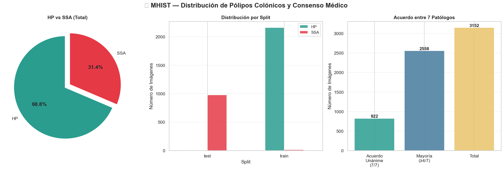

# Informe Guía de Exposición — Dataset 04: MHIST (Wei et al., AIME 2021)

> **Guía del Expositor &mdash; Magíster en Ciencias de la Computación (UDP)**  
> **Estudiante:** Lucas Vicuña (`Petucode`) &bull; **Profesor Guía:** Dr. Jorge Eduardo Zambrano Ibujés  
> **Notebook Asociado:** [`04_MHIST_EDA.ipynb`](../../notebooks/04_MHIST_EDA.ipynb) &bull; **Presentación HTML:** [`04_mhist.html`](../datasets/04_mhist.html)

---

## 1. Resumen de MHIST y Diagnóstico de Auditoría Realizado

**MHIST** (*Minimalist Histopathology Image Analysis Dataset*, Wei et al., AIME 2021) clasifica pólipos colorrectales (`224 × 224 px @ 40x`) en **Hyperplastic Polyp (`HP`, benigno)** vs **Sessile Serrated Adenoma (`SSA`, lesión precancerígena)**, integrando la votación individual de **7 patólogos gastrointestinales**. Su peso completo es mínimo (**~333 MB**), pero su descarga exige aceptar un **Data Use Agreement (DUA)** en Dartmouth BMIRDS.

- **Por qué se purgó el archivo local anterior:** Nuestro proceso de auditoría descubrió que la URL heredada de GitHub daba `HTTP 404` y que el código antiguo generaba silenciosamente un `annotations.csv` sintético defectuoso (`Test = 100% SSA`, `Train = 99.4% HP`, IDs ficticios `MHIST_A00` y votos aleatorios).
- **Estado actual limpio:** Todo archivo sintético fue eliminado. El notebook `04_MHIST_EDA.ipynb` reporta **exclusivamente la Tabla 1 oficial de Wei et al. (2021)** y activa lectura automática real apenas se descarguen los datos vía DUA.

## 2. Cifras Oficiales Verificadas y Tablas Generadas

| Partición Oficial (Wei et al. 2021) | Total Imágenes | HP (Benigno) | SSA (Precancerígeno) | % SSA |
| :--- | :--- | :--- | :--- | :--- |
| Train | 2,175 | 1,545 | 630 | 28.97% |
| Test | 977 | 617 | 360 | 36.85% |
| **Total Benchmark** | **3,152** | **2,162** | **990** | **31.41%** |

## 3. Ejemplos Concretos de Pseudo-Bags y Conexión con la Literatura

- **Pseudo-Bags en `mhist_pseudobags_simuladas.xlsx`:** Muestra exactamente cómo agrupar parches en bolsas sintéticas `K=20`: `bag_0001` (`0 SSA / 20 HP -> Y=0`), `bag_0002` (`3 SSA / 17 HP = 15%`), `bag_0008` (`1 SSA / 19 HP = 5%`).
- **Kang et al. (CVPR 2023, Tabla 3 & 5):** Con solo 3,152 muestras, MHIST demuestra el valor extremo de transferir desde grandes cohortes médicas: un modelo `ResNet-50` ImageNet fine-tuned logra `78.92%`, mientras que pre-entrenado con `MoCo v2` sobre TCGA salta a **`85.88%`** (`+6.96%`), y pre-entrenado en `TCGA + TULIP` (con extractor congelado en *Linear Evaluation*) alcanza **`82.29%`** (superando a `76.25%` de ImageNet supervisado).
- **Puente con Reuniones 08 Oct & 09 Nov:** Relaja la suposición rígida de bolsa binaria extrema estudiando el impacto del desacuerdo médico (casos 4/7 vs 7/7) en la calibración de pesos $\alpha_k$ de Gated Attention.

## Preguntas Probables del Prof. Zambrano (Defensa Oral)

### 1. ¿Vale la pena esperar el DUA de MHIST o seguimos sin él?
> Solicitar el DUA toma 2 minutos y pesa apenas 333 MB, por lo que conviene enviarlo hoy mismo. Sin embargo, nuestro avance experimental NO depende de MHIST: ya tenemos BreaKHis (3.99 GB), PCam Validación (0.86 GB), NCT-CRC-HE completo (15.19 GB) y CAMELYON16 (10.77 GB) listos en disco.

### 2. ¿Qué ganamos al revisar manualmente ese CSV de MHIST durante la auditoría?
> Evitamos construir experimentos sobre un Split corrupto que ponía 100% de negativos en Train y 100% de positivos en Test, un error silencioso que habría arruinado cualquier métrica futura si no inspeccionábamos las salidas tabulares fila por fila.

---
*Generado y auditado sobre cifras verificadas del repositorio (`04_MHIST_EDA.ipynb` y libros `tablas/*.xlsx`). [Volver a la Presentación HTML](../datasets/04_mhist.html) &bull; [Presentación Central 20 Nov](../presentacion_reunion_20_noviembre.html)*
