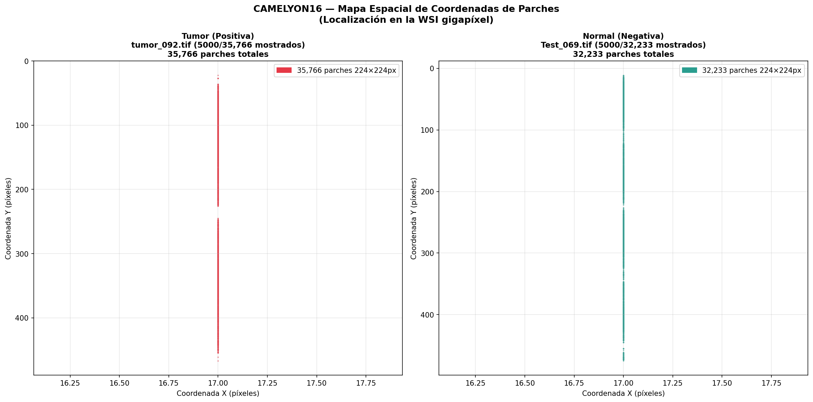
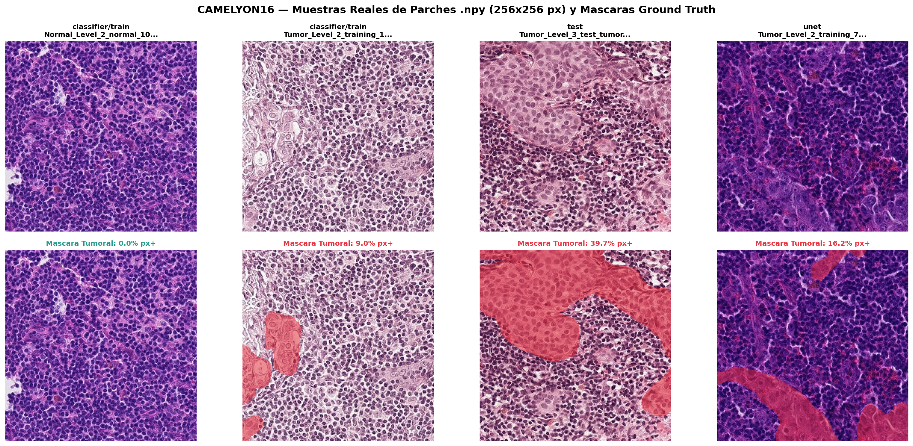
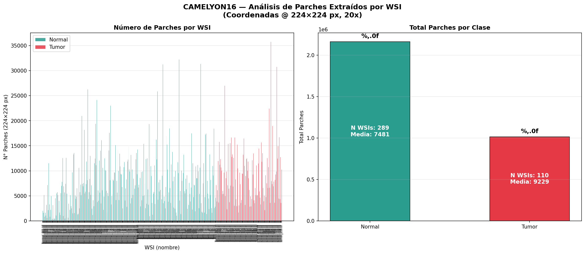
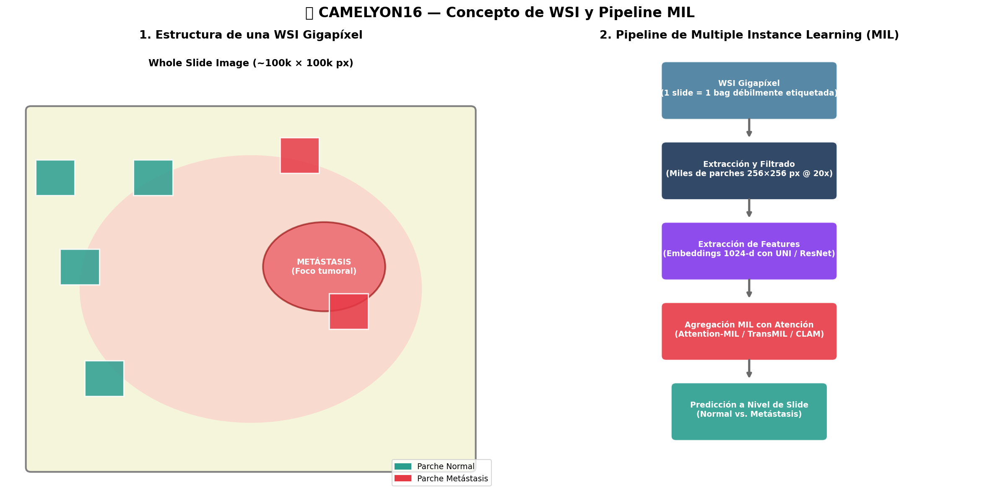

# Informe Guía de Exposición — Dataset 05: CAMELYON16 (Gold Standard MIL)

> **Guía del Expositor &mdash; Magíster en Ciencias de la Computación (UDP)**  
> **Estudiante:** Lucas Vicuña (`Petucode`) &bull; **Profesor Guía:** Dr. Jorge Eduardo Zambrano Ibujés  
> **Notebook Asociado:** [`05_CAMELYON16_WSI.ipynb`](../../notebooks/05_CAMELYON16_WSI.ipynb) &bull; **Presentación HTML:** [`05_camelyon16.html`](../datasets/05_camelyon16.html)

---

## 1. Papel Central de CAMELYON16 en la Tesis (`05_CAMELYON16_WSI.ipynb`)

**CAMELYON16** (Bejnordi et al., JAMA 2017; Litjens et al., GigaScience 2018) es el benchmark estándar internacional para detección de metástasis ganglionar en cáncer de mama sobre **Whole Slide Images (WSI)** gigapíxel (~100,000 × 100,000 px). Mientras las 399 láminas TIFF crudas pesarían **~700 GB**, nuestro repositorio conserva localmente **10.77 GB de activos auditados de altísimo valor**.

- **399 directorios de coordenadas (`36.41 MB` / `3,177,267` parches `224×224`):** `159 Normal Train` (`1,126,118` parches), `110 Tumor Train` (`1,015,190`), `130 Test Oficial` (`1,035,959`).
- **Elasticidad extrema de bolsa:** De **`min = 123`** parches a **`max = 35,766`** parches (`tumor_092.tif`), con **`mediana = 6,813`** y **`media = 7,963`** parches/WSI.
- **111 anotaciones poligonales XML ASAP (`55.84 MB`):** Delimitaciones exactas de metástasis por patólogos + `normal_map.xlsx` (`160` filas).
- **25,235 parches `.npy` rescatados (`10.68 GB`):** Subconjuntos `classifier/train` (10,997), `classifier/val` (1,647), `test` Nivel 3 (2,585) y `unet` (10,006), donde cada archivo contiene `{'image': (256,256,3) uint8, 'mask': (256,256)}`.

## 2. Bugs Auditados y Resueltos en Código y Gráficas

| Archivo Corregido | Problema Detectado Antes | Corrección Verificada Después |
| :--- | :--- | :--- |
| `scripts/analizar_camelyon16_coords.py` | Graficaba `coords[:, 0]` (`level=17` constante -> rayas verticales), incluía Test en Normal e imprimía `'%,.0f'` literal. | Corregido a `coords[:, 1:3]` reconstruyendo anatomía real de `Normal_076` y `tumor_092`, separando `159 / 110 / 130`. |
| `notebooks/05_CAMELYON16_WSI.ipynb` | Dejaba indocumentados `25,235` parches `.npy` (`10.68 GB`) y `normal_map.xlsx`; tarjeta mínima decía 624 en vez de 123. | Genera `camelyon16_patches_inventario.xlsx`, galería `camelyon16_patches_muestras.png` con máscaras en rojo y mínimo dinámico `123`. |

## 3. Ejemplos Numéricos Concretos de Nuestras Tablas (`tablas/`)

- **Extremos espaciales (`camelyon16_coordenadas_extremos.xlsx`):** `Normal_076.tif` (`26,297` parches, `X in [2, 215]`, `Y in [21, 484]`) y `tumor_092.tif` (`35,766` parches, `X in [22, 477]`, `Y in [12, 193]`).
- **Muestra `Normal_001.tif` (`camelyon16_coords_por_wsi.xlsx`):** 2,032 parches a nivel 17 (`X: 65..166`, `Y: 181..487`). Con UNI (1024-d float32), esa bolsa completa ocupa apenas **`~8.3 MB`** en RAM frente a `>30 GB` en espacio de píxeles!
- **Inventario `.npy` por origen (`camelyon16_patches_inventario.xlsx`):** Ej. en `classifier/train`, `Tumor_Level_2_training_77` aporta 1,305 parches, `training_40` 910, `training_96` 855, permitiendo validar localización fina a nivel de celda.

## 4. Conexión Directa con Papers SOTA y Todas las Reuniones

- **Puente con 25 Sep (Zambrano 2022) & CLAM (Lu et al. 2021):** Sorprendentemente, en `CLAM` (pág. 24 Online Methods), Lu et al. NO usan la última capa 2048-d de ResNet50: realizan *adaptive mean-spatial pooling* **después del 3er bloque residual** para obtener embeddings `1024-d` (`K×1024`)! Confirma exactamente la intuición metodológica de Prof. Zambrano.
- **Reunión 08 Oct (VRAM Wall $O(K^2)$):** Mostramos en `06_tendencias_modernas.tex` que más de `8,000` parches desbordan una GPU de 24 GB end-to-end. En CAMELYON16, el promedio es `7,963` y sube hasta `35,766`, probando matemáticamente que la Etapa A offline (UNI/iBOT) es obligatoria.
- **Reunión 09 Nov (Ilse 2018) & TransMIL (Shao 2021):** En TransMIL Tabla 1 sobre CAMELYON16, `Mean-pooling` obtiene `0.4647 AUC`, `Max-pooling` `0.8569`, `ABMIL` `0.8760`, `CLAM-SB` `0.8809` y `TransMIL` `0.9309` (con PPEG + aproximación Nyström de $O(n^2) \to O(n)$).
- **Keshvarikhojasteh et al. (PLOS One, Dic 2025 — `Reducing Variability of MIL...`):** Evalúa en CAMELYON16 (399 WSIs) tanto AUC/F1 como 3 métricas de **confiabilidad espacial** (`MI`, `Spearman r`, `AUPRC`). Demuestra un peligro brutal: **Max-Pooling obtiene `0.80 ± 0.01 AUC` pero `0.00 ± 0.00 MI` y `0.23 AUPRC`**, porque clasifica la lámina tumoral fijándose en tejido linfático normal! Con ABMIL/CLAM/ACMIL la confiabilidad espacial sube ~2.6&times; (`AUPRC 0.59–0.62`, `MI 0.12–0.17`). Nosotros tenemos los **111 XMLs + 25,235 `.npy`** en disco para replicar esta misma validación espacial con `IoU/Dice`!

## Preguntas Probables del Prof. Zambrano (Defensa Oral)

### 1. ¿Por qué no descargamos las 399 láminas TIFF completas de CAMELYON16?
> Pesarían ~700 GB (70× nuestro presupuesto de 10 GB/dataset) y ya poseemos las coordenadas exactas de los 3.17 millones de parches, las 111 máscaras XML y 25,235 parches `.npy` con tejido real en disco. Sumando +1.50 GB de embeddings pre-calculados UNI obtenemos la matriz exacta `[K, 1024]` de todas las láminas en calidad Foundation Model.

### 2. Si ya tenemos las 111 máscaras XML y los 25,235 .npy, ¿por qué entrenar con MIL y no segmentación supervisada directa?
> En clínica real del mundo exterior los hospitales NO entregan máscaras poligonales de una hora por paciente, solo el diagnóstico global de lámina (`Y=0/1`). Por eso el entrenamiento de nuestra red debe ser 100% débilmente supervisado (solo `Y`), usando nuestras máscaras locales ÚNICAMENTE como auditor de interpretabilidad y confiabilidad (Siguiendo a Keshvarikhojasteh 2025).

---
*Generado y auditado sobre cifras verificadas del repositorio (`05_CAMELYON16_WSI.ipynb` y libros `tablas/*.xlsx`). [Volver a la Presentación HTML](../datasets/05_camelyon16.html) &bull; [Presentación Central 20 Nov](../presentacion_reunion_20_noviembre.html)*
